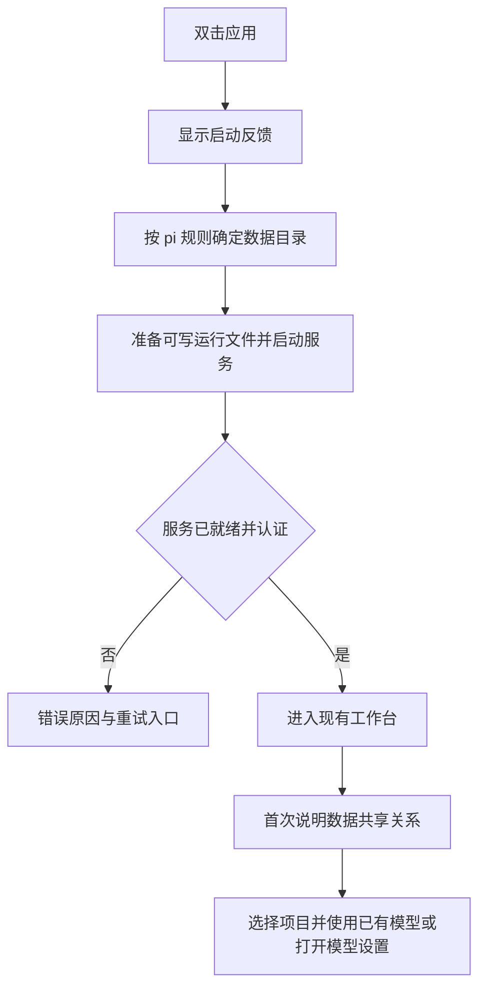
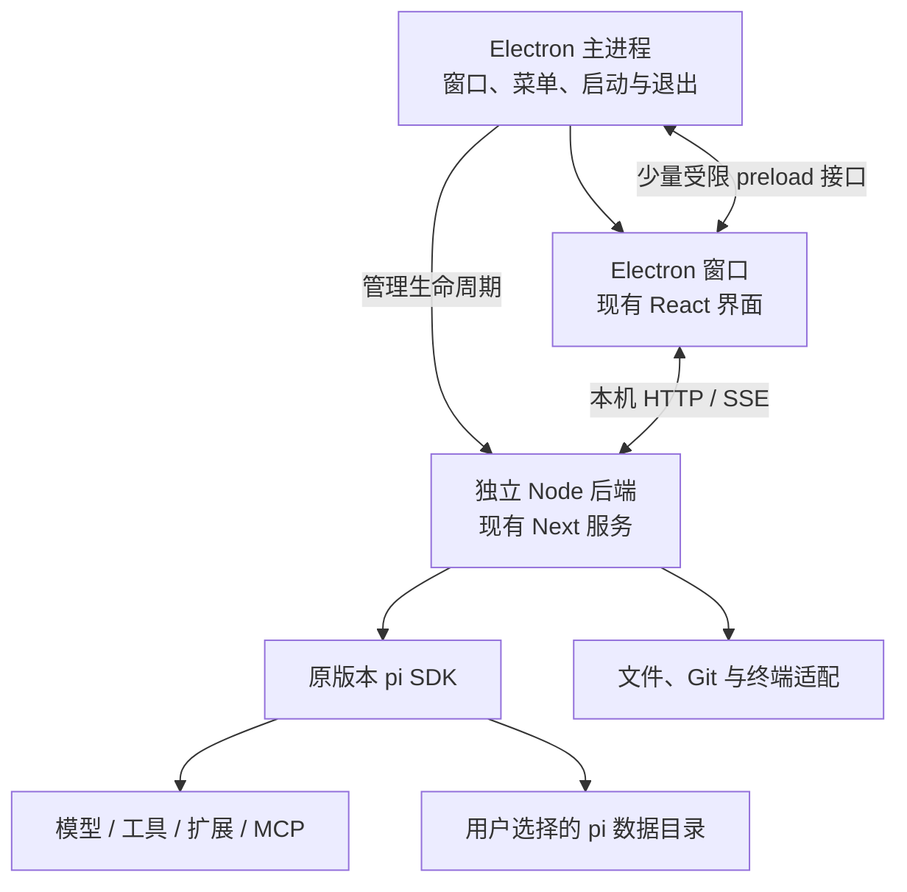

# Pi Web Electron 客户端产品改造方案（历史归档）

版本：v1.1 · 日期：2026-10-19 · 状态：已失效的历史评审背景；不得用于当前实施或判断客户端交付进度。

保留原文件名与 v1.1 正文用于追溯评审过程，不应单独将本文交给实施 Agent 开工。

> 当前实施依据：**Pi Agent SDK + Electron + TypeScript**，直接使用 `pi-agent-core.Agent`，详见[当前技术设计与约束](/Users/liyingjun/Desktop/SW-QA/13-pi/agent-client/docs/技术设计与约束.md)。本文与 v2.0 Web 加壳方案均已失效。下方正文是历史原文，其中独立 Node/Next 服务、多窗口等要求不再约束当前工程。

## 0. 复核结论与本次优化

**整体可行，保留“Electron + 独立 Node + 现有 Next 服务”的主架构。原方案没有发现必须改动 pi 的硬性障碍，但存在范围扩大、实现细节未闭合和承诺过强的问题，不能直接据此承诺产品交付。**

复核将问题分为三类：必要的桌面适配继续做；与桌面启动无直接关系的增强后移；尚无运行证据的打包和清理假设先设验证关卡。以下结论来自源码与配置检查，不代表已跑通 Electron 安装包。

| 原设计 | 复核判断 | v1.1 优化 |
|---|---|---|
| 独立 Node 后端 | 合理的兼容性选择，不是强行适配。现有代码依赖普通 Node、npm/npx 布局和原生终端模块 | 保留；接受体积成本，固定并验证运行时 |
| 全量 IPC 或静态网页候选路线（原稿已排除） | 改动大且无必要，还会破坏现有后端职责 | 维持排除结论 |
| 为保留 localStorage 而在端口冲突时禁止继续启动 | 为技术细节牺牲主要使用路径 | 优先复用上次端口；冲突时允许换端口继续，并明确少量界面偏好可能重置 |
| 整套后端复制到用户目录 | 可做，但复制依赖和原生二进制会增加体积、首启、签名与更新验证成本；原文没有明确布局 | 优先只准备可写运行文件；Node、依赖与静态资源保留在应用资源目录，路径方案列入 S0 验证 |
| 首次强制选择两种数据模式 | 并非桌面化所必需，增加向导与分支 | 默认沿用 pi 的目录规则，说明共享关系；独立目录选择界面后移 |
| 首版新增跨重启文本草稿 | 有价值，但需要存储、清理和提交确认规则，属于新增业务能力 | 后移 P1；P0 如实说明未发送草稿只在当前运行中保留 |
| 为每个异常轮次精确标记“已中断” | 现有文件与进程状态不足以可靠识别每个任务的最后状态，需额外执行记录 | P0 只显示应用上次未正常退出的提示；历史按实际记录读取，不制造任务结论 |
| 关窗隐藏并长期保留窗口 | 可行但引入后台节流、租约、通知与资源管理，不宜默认为最小改造 | P0 关主窗口走退出流程；最小化保留运行；关窗驻留后移 P1 |
| 关闭超时等待用户决定，同时复用原启动器 | 行为冲突：原启动器 5 秒后自动 SIGKILL | 桌面层独立管理退出时序，不直接复用该强制退出策略 |
| 保证任何退出后所有后代进程都消失 | 对已脱离进程组的扩展、守护进程及强杀场景无法普遍保证 | 保证正常退出时已管理的后端、终端与受测 MCP 被清理；异常场景做有限清理并列明边界 |
| 站内导航与系统浏览器的链接分流规则 | 尚未覆盖需要桌面 Cookie 的 HTML 导出、PDF 和文件预览 | 增加受控预览/下载分流；外部浏览器不接收本地会话凭据 |
| 认证接入和环境过滤的改造范围尚不具体 | 复核确认现有 Cookie 登录、bash/MCP/终端过滤已覆盖大量需求 | 将实施边界收紧为直接复用和验证，只补确切缺口 |

优化目标不是消除所有桌面适配，而是让每项改动都能追溯到“可安装启动、维持现有能力、正常退出”。后台、草稿和任务恢复增强可后续独立验证。

## 1. 产品决策与约束

**将现有 Pi Web 改造成可安装、双击启动的本地桌面客户端；复用 React / Next.js 界面与服务端，保持 pi 框架及其数据格式不变。**

用户已确认：本方案是独立的 Pi Web 桌面化方案，优先减少改动，不并入工作区现有的 AQA / Vue 工作台方案，也不替代该方案。

| 项目 | 本方案决策 | 状态 |
|---|---|---|
| 改造对象 | `/Users/liyingjun/Desktop/SW-QA/pi-web-main`，当前 package.json 为 0.12.2 | 已核实 |
| 桌面框架 | Electron | 用户要求 |
| pi 边界 | 不修改、不 fork、不补丁修补 `@earendil-works/pi-*` 包；沿用当前锁定版本 | 硬约束 |
| 业务技术栈 | 保留 React / Next.js，业务继续通过 HTTP API / SSE 通信 | 推荐决策 |
| 运行环境 | 应用携带独立 Node 后端及必要依赖 | 推荐决策 |
| 首发平台 | macOS，先验证 Apple Silicon；Intel 单独验证后再宣布支持 | 暂定范围，待实施前确认 |
| 产品名称 | 暂称 Pi Web Desktop，正式名称、图标和包标识发布前确定 | 待确认 |
| 数据策略 | 默认沿用 pi 数据目录规则，首次说明共享关系；独立目录选择界面后移 P1 | 优化决策 |
| 首版交付 | 可安装、可运行、可退出、可恢复历史的本地客户端 | 推荐范围 |

本次源码分析未发现必须修改 pi 框架的架构障碍。但原项目目录没有 `node_modules` 和 `.next`，因此“可行”是源码层面的结论，正式投入完整开发前须通过第 8 节的验证关卡。

## 2. 用户价值与成功标准

目标用户是已使用或准备使用 pi 处理本地项目的开发、测试和技术用户。首版解决启动、窗口管理和运行环境交付问题，保留现有任务处理方式。

| 现有使用过程 | 改造后体验 | 成功标准 |
|---|---|---|
| 打开终端，准备环境并启动 Web 服务 | 安装后双击应用 | 核心聊天无需用户自行安装 Node 或手动启动服务 |
| 在浏览器地址栏访问本地端口 | 独立应用窗口与 Dock 入口 | 不打开普通浏览器标签页作为主界面 |
| 浏览器与服务进程生命周期分离 | 应用负责启动、状态提示和退出清理 | 关主窗口和退出使用同一清理流程；正常退出清理已管理进程 |
| 故障主要通过终端日志定位 | 应用内提供原因、重试和诊断入口 | 启动失败不会停在无提示白屏 |
| 使用现有 pi 配置和历史 | 默认沿用 pi 数据目录并显示实际位置 | 沿用目录不迁移、不重写历史格式 |
| 更新依赖或重新执行命令 | 下载并替换应用，保留用户数据 | 更新应用不清空历史和桌面偏好 |

本地优先是指项目与会话存储在本机。模型服务、OAuth、插件下载和部分 MCP 功能仍可能联网，不将客户端描述为“完全离线”。

## 3. 功能范围与优先级

P0 是首个可交付安装包必须满足的范围；P1 是在稳定首版上补充的桌面体验；P2 是后续独立立项，不作为首版验收条件。

| 编号 | 能力 | 改造方式 | 优先级 |
|---|---|---|---|
| D01 | 安装、启动、单实例 | 新增 Electron 入口、运行时交付、启动状态、重复启动聚焦 | P0 |
| D02 | 首次使用 | 说明实际数据目录与共享关系，复用现有模型配置和项目选择 | P0 |
| D03 | 对话与流式输出 | 复用现有消息、工具卡片、停止和 SSE 逻辑 | P0 |
| D04 | 会话与项目 | 复用历史、重命名、置顶、归档、分支和项目切换 | P0 |
| D05 | 文件与 Git 查看 | 复用文件预览、上传、Diff 和现有 worktree 能力 | P0 |
| D06 | 终端 | 保留现有 xterm / node-pty，验证打包与退出清理 | P0 |
| D07 | 模型、扩展、技能与 MCP | 保留现有入口，验证代表性集成，缺少依赖时明确提示 | P0 |
| D08 | 窗口与退出 | 原生标题栏、基础菜单、窗口尺寸记忆、关主窗口退出、最小化保留运行 | P0 |
| D09 | 桌面浏览行为 | OAuth/外链交给系统浏览器；站内会话、需认证的预览和下载分别处理 | P0 |
| D10 | 历史与异常提示 | 读取落盘历史；应用级非正常退出提示；不自动重发消息或重放工具 | P0 |
| D11 | 故障诊断 | 启动错误、服务断开、重试、脱敏诊断导出 | P0 |
| D12 | 安装包交付 | 目标架构构建、签名与公证、手动升级验证、第三方许可清单 | P0 |
| D13 | 系统通知 | 在窗口隐藏时可靠提示完成或等待输入，点击回到对应会话 | P1 |
| D14 | 原生目录选择 | 在现有目录选择器旁增加系统选择入口，保留原校验链 | P1 |
| D15 | 自动更新 | 检查、下载、空闲时安装与失败回退 | P1 |
| D16 | 多平台 | Windows、Linux 与各架构分别完成依赖及生命周期验证 | P2 |
| D17 | 文本草稿与最近位置 | 跨重启恢复、提交后清理、数据目录与会话隔离 | P1 |
| D18 | 关窗驻留 | 完成隐藏窗口、通知、租约及资源回收验证后提供 | P1 |
| D19 | 独立数据目录界面 | 通过现有环境变量选择独立目录，不迁移 pi 数据格式 | P1 |

P0 不新增精确的任务断点恢复或执行日志系统。正常读取历史与重放执行是不同能力。

首版不新增文件编辑器、Git 提交工作流、任务调度、云同步、多用户权限、多引擎切换或插件市场协议。已有子智能体能力保持现有语义，不新增调度平台。

“保留扩展能力”不代表所有第三方扩展已通过兼容性认证。交付时提供已验证的运行时与集成矩阵，不能把任意扩展、任意系统命令都宣传为开箱即用。

## 4. 信息架构与界面设计

### 4.1 界面组织

主工作区沿用 Pi Web 的主题、布局、字体设置及响应式行为，不做整套视觉重设计。新增内容集中在三个位置：

| 位置 | 内容 | 设计要求 |
|---|---|---|
| 启动窗口 | 准备应用、连接本地服务、失败恢复 | 有真实阶段名称，不伪造进度百分比 |
| 主工作窗口 | 现有项目、会话、聊天、文件和终端 | 现有操作位置基本保持；异常时才显示状态横幅 |
| 应用菜单及桌面设置区 | 关于、窗口操作、诊断、数据位置、手动更新入口 | 产品内容使用日常语言；端口和进程信息放入诊断详情 |

原生标题栏优先，首版不做无边框窗口及复杂自绘菜单。初始尺寸建议 1280 × 840，最小尺寸暂定 960 × 640，实施时验证聊天、输入区和终端是否可用后确定。缩小窗口优先收起辅助面板，不裁切主要操作。

菜单保留系统惯例：关于、设置、退出、编辑、显示、窗口、帮助。macOS 使用 Cmd+Q 退出、Cmd+W 关窗、Cmd+, 打开设置；复制粘贴等标准编辑操作由原生菜单支持。业务快捷键先复用现有定义，避免与终端和输入法冲突。

### 4.2 首次启动流程

P0 默认使用 pi 已支持的目录规则：启动环境明确提供 `PI_CODING_AGENT_DIR` 时沿用该值，否则使用 `~/.pi/agent`。不读取或执行用户的 shell 配置文件来猜测环境变量；Finder 双击启动不保证继承终端中的变量。

首次进入工作台展示实际目录，并说明桌面端与 CLI 会共用该目录中的历史、配置与凭据。没有历史时直接使用现有空状态；没有模型配置时允许浏览历史，再由用户进入现有模型设置。不另建一套模型配置向导。

已有独立目录需求可在技术验证时通过环境变量验证，面向普通用户的目录选择与切换界面属于 P1。P0 不自动复制凭据，不扫描用户磁盘寻找其他配置，也不在运行中切换目录。

### 4.3 日常任务流程

打开项目 → 选择或新建会话 → 配置模型或沿用当前模型 → 输入任务 → 查看流式回复和工具结果 → 停止或继续下一轮。

当前项目、会话和模型继续显示在现有位置。连接异常时输入内容保留，发送动作暂不可用；恢复连接后由用户决定是否发送，避免重复执行。对请求是否已被后端接受无法确定时，先核对会话状态，不自动重发。

### 4.4 关窗、退出与系统休眠

| 用户动作/事件 | P0 应用行为 | 用户可见结果 |
|---|---|---|
| 点击主窗口关闭 / 在主窗口 Cmd+W | 进入与 Cmd+Q 相同的退出流程 | 存在任务、终端或草稿时提示，不静默丢弃输入 |
| 最小化或切到其他应用 | 保留窗口和服务，沿用现有运行逻辑 | 恢复窗口后与后端重新核对状态 |
| 再次点击应用 | 聚焦已有窗口，不启动第二个服务 | 返回现有工作区 |
| 退出且有活动任务、终端或未发送输入 | 提示“退出将停止任务和终端，未发送内容不会保留” | “取消”与“退出应用”，默认取消 |
| 无法取得可靠活动状态 | 保守显示同一退出提示，不展示猜测的任务数量 | 用户可取消退出；不为此新增任务统计系统 |
| 确认退出 | 阻止新操作，关闭页面连接，正常停止服务与已管理子进程 | 显示“正在退出…” |
| 正常清理超时且进程仍存活 | 提示继续等待或强制退出 | 不承诺已经停止全部外部进程 |
| 系统休眠/网络切换 | 不阻止休眠，唤醒后核对状态 | 不保证休眠期间继续执行，也不自动重放请求 |

P0 的关窗即退出是缩小生命周期范围的产品取舍，与常见 macOS 关窗保留应用习惯不同，须在首次提示中说明。需要暂时离开时使用最小化。P1 再考虑符合 macOS 习惯的关窗驻留，不用一个长期隐藏的渲染页面充当后台任务调度器。

活动状态优先复用 `/api/agent/running` 和当前页面已知的终端、草稿信息；状态不明时保守提示。退出请求幂等，只出现一次确认；一旦进入真正清理阶段，不假装仍能撤回已经停止的任务。

最小化也会涉及页面后台节流，必须验证 SSE、终端与重连；不能通过全局禁用节流或永不回收会话来掩盖问题。Agent 运行状态以服务端为准，不能因页面隐藏就判定结束。

### 4.5 错误与恢复

| 场景 | 主文案示例 | 可执行操作 |
|---|---|---|
| 本地服务启动失败 | “应用未能启动，请重试。你的历史记录仍保存在本机。” | 重试、查看诊断、退出 |
| 上次端口被其他程序占用 | “连接位置被占用，可使用新连接继续。部分界面偏好可能恢复默认，历史与模型配置不受影响。” | 换用空闲端口、重试；不结束其他程序 |
| 数据目录无权限或已移走 | “无法访问 pi 数据目录。” | 显示实际路径、权限排查建议、重试 |
| 模型认证失败 | “模型连接失败，请检查当前服务的凭据。” | 打开现有模型设置 |
| MCP / 插件缺少外部命令 | “该功能需要的程序未找到。” | 展示缺失项与设置入口，保留其他功能 |
| 后端意外退出 | “本地服务已中断，部分任务可能未完成。” | 重启服务、查看历史和诊断 |
| 上次非正常退出 | “上次应用未正常退出，部分操作可能未完成，请检查会话和文件后继续。” | 浏览历史；不据此给每个会话标记失败 |

错误使用文字加状态图标表达，不只依赖颜色；对话框有明确焦点、键盘操作和关闭路径。加载反馈只展示实际阶段，操作失败保留用户输入，并提供具体恢复动作。

## 5. 数据、草稿与兼容规则

### 5.1 数据归属

| 数据 | 保存位置/所有者 | 改造原则 |
|---|---|---|
| pi 会话、模型、凭据、技能与插件配置 | 按 pi 规则确定的 agent 目录及现有项目目录 | 沿用 SDK 行为和格式，不新增 pi 专属协议字段 |
| 窗口尺寸、上次端口、正常退出标记 | Electron 用户数据目录 | 最小桌面状态，不混入 pi 设置或重建任务数据库 |
| 主题及现有浏览器偏好 | Electron 持久化浏览器分区 | 同一来源正常保留；换端口可能恢复默认，不自动继承系统浏览器数据 |
| 未发送的文本草稿 | P0 沿用现有内存存储；跨重启存储后移 P1 | P0 退出提示不保留，不提供虚假的恢复承诺 |
| 可写运行文件与缓存 | 用户数据目录下按构建标识区分的运行目录 | 仅复制实际需要写入的内容；原始运行时及依赖留在应用资源目录 |
| 日志和诊断 | 用户数据目录的诊断子目录 | 限量保留，不默认记录完整对话、文件正文或密钥 |

现有 `lib/draft-store.ts` 使用内存 Map。P0 沿用该行为，当前运行中的会话切换不丢草稿，应用退出或页面重载后的恢复不作承诺。P1 再设计持久化、会话键、发送确认后清理、附件策略及数据目录隔离，避免把它作为桌面启动的前置条件。

### 5.2 历史与运行状态

正常重启读取现有落盘历史；最近位置和跨重启草稿恢复后移 P1。后端重启后不把上次“运行中”的 UI 标记当作仍在运行的证据。

会话记录里已落盘的消息按原有逻辑显示。P0 只记录应用启动/正常退出标记，遇到上次未正常退出显示应用级提示，不从缺少结束消息推断每个轮次的最终执行结果。恢复历史不自动续跑模型、写文件、命令或 MCP 调用；用户检查后再发起下一轮。退出不会撤销已经发生的修改。浏览历史所需的 SDK 会话初始化可能仍运行扩展生命周期钩子，不能宣传为“绝不运行任何扩展代码”。

沿用现有 pi 目录只表示数据格式和配置可共享，**不承诺 CLI 与桌面端同时写同一个会话具有并发保护**。首版说明避免双端同时操作同一会话，不通过猜测锁文件或强制结束 CLI 来“解决”冲突。

### 5.3 升级和卸载

P0 使用手动更新：关于页面展示桌面版版本与下载入口，退出应用后替换安装包。现有面向 npm 的 Pi Web 更新提示在桌面模式下隐藏或替换，不引导用户对应用包执行 npm 更新。

更新应用不得覆盖 agent 数据目录。新版本的可写运行目录通过临时目录准备完整后再启用；准备失败不删除旧目录，但旧目录存在不代表旧应用仍可运行。P0 不承诺自动回滚，用户需用已保留的旧安装包手动恢复。SDK 数据格式兼容性单独评估，版本回退不能撤销数据变更。

删除应用本体不会主动删除共享 pi 数据。清理独立数据应成为明确的用户操作，首版不实现“一键清空全部数据”。

## 6. 技术方案与职责边界

### 6.1 选型比较

| 路线 | 特点 | 结论 |
|---|---|---|
| Electron + 独立 Node + 现有 Next 服务 | 保留现有 API、SSE、SDK 与普通 Node 环境，安装体积较大 | 推荐 |
| Electron + Electron 自带运行时承载后端 | 可减少一份运行时，但需核对原生模块、Node 版本、进程启动和扩展假设 | 不作为首版基线 |
| 纯静态前端 + 全部改为 IPC | 需要重写现有 API、认证、流式通信和不少调用点 | 不符合最小改造目标 |
| Vue 工作台重建 | 可形成新产品，但属于现有 AQA 的另一条路线 | 本方案不采用 |

### 6.2 推荐架构

Electron 主进程不承载 AgentSession，不直接接管 pi 的上下文、工具协议和模型调度。业务继续在现有 Next 服务进程内使用 pi SDK，避免引入第二套会话状态。

原生接口只用于确需系统交互的少量能力，例如诊断导出、窗口控制和后续目录选择。不得向页面暴露任意命令执行或任意文件读写的通用 IPC。

### 6.3 服务启动与运行目录

1. 获取单实例锁，按 pi 规则确定数据目录，载入上次端口和窗口设置。
2. 准备当前构建的可写运行目录，保留现有 Next 运行密钥轮换。
3. 使用内置 Node 的绝对路径启动现有 Next 生产服务，仅监听 `127.0.0.1`。
4. 等待实际绑定成功，完成受认证的就绪核对后再加载界面；日志文字仅作辅助。
5. 使用应用专用浏览器分区登录现有 Web 认证接口，再打开工作窗口。
6. 主进程管理正常退出、超时及异常断连；不复制第二套会话控制系统。

**端口策略：** 优先使用上次成功的端口，首次启动选择空闲端口。冲突时提供换用空闲端口继续的入口；提示基于该来源存储的部分界面偏好可能恢复默认，但落盘历史和模型配置不受影响。用户确认后保存新端口。不为避免偏好重置而引入反向代理、自定义页面协议或全量 localStorage 同步系统。

空闲端口探测存在“探测后被抢占”的竞态，实际监听失败必须重试或返回可恢复错误。不能探测到 HTTP 200 就把现有端口当作本应用服务。桌面适配器应验证本次启动身份，必要时添加一个极小的、认证保护的健康接口；只报告服务就绪，不能创建 AgentSession。具体实现由 S0 选择，禁止依赖未核实的 Next 私有启动接口。

**启动方式：** 保留普通 Next 生产服务。桌面适配器可复用现有 CLI 的配置与准备逻辑，但不直接套用其自动开浏览器、5 秒强杀和父进程退出逻辑。没有必要为了进程就绪通知重写 Next HTTP 服务或全部路由。父子进程控制只处理生命周期与就绪，不承载聊天命令。

**退出一致性：** 现有 `bin/process-lifecycle.js` 的强杀期限与 `lib/rpc-manager.ts` 中 Pi Web 会话封装的扩展关闭期限均为默认 5 秒，直接叠用可能在扩展尚未清理完时强杀。桌面层使用独立退出预算，至少覆盖会话关闭与额外收尾时间；先发正常关闭信号，关闭页面长连接，等待已管理进程退出。超过预算且进程仍存活时才让用户决定继续等待或强制退出。单个扩展仍可能按原有 5 秒策略被释放，不承诺无限等待它完成，也不为此修改 pi 框架。

正常退出验收覆盖应用后端、已管理终端和代表性 MCP。父进程异常消失时，用受控进程通道断开触发后端自清理；后端被直接强杀、系统崩溃或扩展主动 daemonize 时，只能提供有限清理。不得根据程序名扫描并杀死全部 node、shell 或用户外部服务。

### 6.4 打包约束与待验证布局

**推荐先验证“应用资源只读、可写运行文件分离”的布局。** 原方案直接复制整套后端并非不可行，但没有必要预先承担完整依赖副本的成本。

| 内容 | 建议位置 | 处理 |
|---|---|---|
| Electron 主程序、独立 Node、npm/npx、后端运行依赖与原生模块 | 安装包资源目录，位于 ASAR 外的适当目录 | 构建时准备与签名，不在运行时安装或重编译 |
| 原始 Next 构建、public、生产配置 | 安装包资源目录 | 作为随应用版本更新的源文件 |
| 需要写入的 Next 运行产物、缓存与 manifest | 用户数据目录中按构建标识区分 | 首次启动或更新时准备，后续复用；不修改已签名应用包 |
| pi 数据与日志 | 各自用户目录 | 与可重建运行产物隔离 |

Next 的运行目录同时承担配置、资源和模块解析，**不能假设复制一个 manifest 就足够**。S0 需验证将必要 `.next` 内容放入可写运行目录，同时以明确路径或链接引用只读依赖和 public；核查 `next.config.ts` 的 `configDir`、SDK 动态 import、原生辅助程序以及实际产生的缓存。移动应用位置或升级后链接也要可重建。不要把 `NODE_PATH` 当作通用 ESM 模块解析修复。

若分离布局在当前 Next 版本下不可靠，允许 S0 使用完整后端运行副本作为备选，但必须记录复制大小、首启时间、原生二进制签名行为和旧副本清理成本，再决定能否进入产品版本。两种方案都不得补丁修补 Next 或 pi 内部实现。优先验证标准生产依赖布局，不抢先切换 standalone 或单文件打包。

其他约束：

- 建议使用 electron-builder，Electron 壳与普通 Node 后端的依赖构建分开。不能让打包工具为 Electron 自动重建后端的 node-pty；它应匹配实际后端 Node 的 ABI、系统和架构。
- 项目及当前锁文件的 pi / undici 要求 Node `>=22.19.0`。选定受支持的具体版本，固定并验证，不能只检查根 package.json。
- 后端保留所需 SDK 文件结构和唯一依赖来源，验证 MCP 的动态路径与类型身份；Node、npm/npx 一并按兼容目录布局交付。
- Git、Python、uv、用户 shell 及特定 MCP 依赖不默认打包。功能被使用时检查所需程序，明确提示缺失；不为此建立通用环境安装器。
- 用户 shell/项目命令不应被强制改用应用内置 Node；桌面后端用绝对路径，npm/npx 和 MCP 的 PATH 传递分别验证，避免覆盖用户项目原本的运行时选择。
- bash 和 MCP 不保证读取用户终端中的初始化脚本。Finder 启动下的 PATH、代理与现有模型配置分别验证；缺项给出具体说明，不自动执行所有 shell 启动文件。
- node-pty 的 macOS 辅助程序在构建时保留执行权限并签名，安装后不要求用户运行权限修复或重新编译。
- 隔离发布构建与开发 `.next`；安装包验证包括无开发机依赖的测试账号、只读安装位置和签名环境。

### 6.5 本地访问与认证

渲染窗口使用 `nodeIntegration: false`、`contextIsolation: true`，启用适用的渲染沙箱；保持 Web 安全策略，不以关闭同源检查解决集成问题。

本地服务沿用现有 Host / Origin 校验和 Web 认证能力。桌面层每次启动生成临时 `PI_WEB_PASSWORD`，通过当前 `POST /api/web-auth` 完成登录，为应用专用浏览器分区设置 HttpOnly Cookie；该分区里的 fetch、SSE、预览和下载继续使用既有认证链。主进程请求不能假设自动共享 Chromium Cookie，必须明确处理该分区的登录与 Cookie 写入，并在加载页面前验证成功。不新增令牌协议，也不将其改成面向用户的登录页。

临时凭据不写入 URL、持久日志、对外链接或页面全局变量。复核确认现有 `project-command-env.ts`、`mcp-transport.ts` 和终端路径已过滤 `PI_WEB_PASSWORD`，优先复用；新增启动链及 npm/npx 子进程单独检查，只补已证实的遗漏。不要先行重写整套环境过滤。应用退出/服务重新认证时清理失效的桌面认证状态，模型凭据仍按 pi 原有方式存储。

新窗口和页面导航必须按真实用途分流：

| 类型 | 桌面处理 |
|---|---|
| 站内会话、新会话链接 | 切换主工作窗口内的会话；不得直接整页重载导致内存草稿丢失；不新增多工作窗口管理 |
| OAuth 与普通外部 HTTP(S) 网页 | 系统浏览器；保持提供商既有回调/验证码流程 |
| `/api/sessions/.../export?inline=1`、需登录的 PDF/文件预览 | 在共享认证分区的受限预览窗口打开，或通过该分区下载；不能简单丢给未登录的系统浏览器 |
| 文件下载、Blob 导出 | 保留下载语义，由 Electron 下载处理选择保存位置；不交给系统浏览器重新请求 |
| 未识别协议和来源 | 默认不授予系统执行能力，错误可见 |

预览窗口关闭只关闭预览，不触发主应用退出；预览窗口不注入业务 preload，不拥有任意本机操作能力。保留现有文件预览的隔离规则，不能因同一来源就放开渲染权限。外部页面始终不进入带桌面能力的窗口，不能为了让导出链接可用把会话凭据传给外部浏览器。

本机认证限制其他网页或程序误用接口，不将其宣传为对同一系统用户下恶意进程的强隔离。原有 Agent 工具仍具有其既有本机执行能力，本项目不新增操作系统级沙箱承诺。

## 7. 最小改动清单

以下是建议的实现位置，不代表文件已创建。

| 位置 | 必要改造 | 不改动的责任边界 |
|---|---|---|
| 新增 `desktop/` | 主进程、preload、启动/退出、窗口、菜单、诊断 | 不复制 AgentSession 业务逻辑 |
| 新增桌面构建配置 | 平台依赖、应用标识、资源、签名与安装包 | 不修改 pi 包源码 |
| `package.json` / 锁文件 | 桌面开发与打包命令、必要开发依赖 | 保持当前 pi 版本，SDK 升级另行评估 |
| `next.config.ts` | 仅在发布产物验证证明需要时调整资源收集 | 不先行迁移静态导出或全量重构 |
| `bin/` 或桌面服务入口 | 运行副本、就绪报告、父子进程管理 | 保留浏览器 CLI 现有使用方式 |
| 现有 Web 认证接口与环境传递处 | 优先直接复用；仅在验证发现缺口时补充 | 不先行修改 proxy 或认证算法 |
| `components/PwaRegistration.tsx` | 桌面模式禁用 PWA 注册与 Web Push 专属路径 | Web 模式继续可用 |
| 外链、更新、下载相关组件 | 桌面行为分支，避免安装包内执行 npm 自更新 | 原业务 API 保持一致 |
| `lib/draft-store.ts` | P0 不改存储，退出时提示；持久化 P1 独立实现 | 不把草稿功能重构塞入桌面首版 |
| 生命周期相关逻辑 | 桌面入口独立退出预算，复用会话清理，核对进程归属 | 不照搬 CLI 的 5 秒强杀策略，不承诺清除任意守护进程 |

通过显式桌面能力标记识别运行环境，不只匹配 User-Agent。新增界面文字沿用现有国际化机制，补齐现有语言资源。

原项目贡献文档把桌面模式和新子系统视为可能超出上游范围。本方案是用户授权的独立产品改造，不将上游是否接收 PR 当作实施前置条件，也不假设这些改动会被上游合并。桌面入口集中管理，有利于后续同步 Pi Web 修复。

## 8. 可行性风险与验证关卡

| 风险 | 影响 | 处理方法 | 必须看到的证据 |
|---|---|---|---|
| 原生模块或签名不匹配 | 安装后终端不可用 | 固定运行时、分架构构建和签名 | 安装包中终端可输入、调整尺寸和正常关闭 |
| SDK 动态文件遗漏 | MCP、扩展启动失败 | 保留目录结构，测试代表性加载链 | 至少一种 stdio MCP 与扩展运行成功 |
| 应用包只读与模块解析耦合 | 密钥轮换、缓存或 SDK 加载失败 | S0 验证可写运行文件分离；不可靠时评估完整副本 | 从标准安装位置启动、资源无缺失、签名环境下功能可用 |
| GUI 启动环境缺少 PATH/代理 | 模型或外部命令无法连接 | 明确环境发现与依赖提示 | 不经终端直接双击也能工作，代理场景通过 |
| 最小化影响连接/回收 | 任务或终端显示不一致 | 核对租约、后台节流与重连；后台驻留后移 | 最小化后恢复能核对真实状态，不用禁用全部回收来掩盖问题 |
| 退出预算冲突或孤儿进程 | 扩展提前被杀、端口占用 | 独立桌面退出预算、父子通道断开检测、受控清理 | 正常退出、超时、主进程崩溃测试；强杀/脱离进程组限制已说明 |
| CLI 同会话并发写入 | 状态分叉或数据竞争 | 明确共享范围，不宣称跨进程互斥已实现 | 数据策略与已知限制在产品中可见 |
| Electron + Node 体积与内存 | 安装大、启动慢 | 首版先测量，不为缩包改写 SDK 或协议 | 目标机器的安装体积、运行副本大小、启动及空闲内存记录 |
| 认证与导出预览冲突 | 外部浏览器打不开受保护内容 | 应用分区内预览或下载 | HTML 导出、PDF、Blob 下载与 OAuth 分别通过 |
| 自动按 Electron 重建后端原生模块 | Node 后端无法加载终端 | 壳与后端依赖分开构建 | 安装包中实际独立 Node 可加载 node-pty |

**Go / No-Go 原则：** 如果不改 pi 即可实现可安装启动、核心对话、终端与代表性扩展，并完成退出清理，则进入产品开发；如果必须依赖修改 pi 私有方法才能满足目标，先回到方案评审，优先缩小首版范围，不直接突破硬约束。

## 9. 验收用例与质量标准

| 编号 | 操作与前提 | P0 验收结果 |
|---|---|---|
| A01 | 干净测试账号，无用户自装 Node，安装后双击 | 核心聊天可用；不要求手动启动服务；外部工具依赖单独说明 |
| A02 | 连续双击两次 | 只有一个桌面实例及其服务，已有窗口聚焦 |
| A03 | 默认目录存在 pi 历史与配置 | 正确读取并说明共享；不做格式迁移、不自动复制凭据 |
| A04 | 在受控测试中指定 `PI_CODING_AGENT_DIR` | 沿用 SDK 规则；原默认目录不因本次初始化被改写 |
| A05 | 发起真实模型任务并停止、再次发送 | 流式输出和工具结果正常，停止按实际状态显示 |
| A06 | 中文输入、切换会话、站内新窗口链接 | 组合输入不误发送；不因整页重载破坏内存草稿 |
| A07 | 有草稿时退出并取消，再确认退出重启 | 取消不丢输入；确认退出前明确告知未发送内容不保留；重启不自动发送 |
| A08 | 文件读取、上传、Diff、Finder 定位 | 与原有访问边界一致 |
| A09 | 终端受控长命令、调整尺寸、停止与关闭 | 安装包里的 Node 可加载 PTY；正常退出后已管理测试进程结束 |
| A10 | 代表性扩展、技能、stdio MCP；缺 Git/Python 等依赖 | 支持矩阵中的功能可用；缺项准确提示，不能把“未安装”伪装为“功能已支持” |
| A11 | OAuth、外链、HTML 导出、PDF、Blob 下载 | 按第 6.5 节分流，不泄露凭据，文件实际可打开 |
| A12 | 最小化后恢复；系统休眠后唤醒 | 与后端重新核对；不误报完成，不自动重发或重放 |
| A13 | 关主窗口、Cmd+Q、清理超时、关闭预览窗口 | 主窗口统一退出；取消可继续；超时行为一致；预览关闭不退出应用 |
| A14 | 注入后端退出及主进程异常 | 可见错误和重试；有应用级异常提示；不虚构逐任务中断结论、不重放工具 |
| A15 | 占用旧端口、移走数据目录、运行目录不可写 | 可换端口继续且说明偏好影响；其他错误可诊断；不连接陌生服务、不删数据 |
| A16 | 无认证访问本地 API；重新启动后的旧 Cookie | 未认证请求被拒，旧认证失效；应用自身 API/SSE/上传正常 |
| A17 | 手动替换应用、运行目录准备中断、移动安装位置 | pi 数据保留；构建产物准备可重试；资源路径可用；不宣称自动回滚 |
| A18 | 原 Web 模式回归 | 桌面标记、PWA 与链接适配不破坏浏览器模式 |

P1 草稿恢复、关窗驻留、独立目录选择、自动更新和后台通知各自增加验收，不以 P0 实现情况宣称已支持。

S0 记录真实启动耗时、安装体积、可写运行副本大小与空闲内存，再确定性能目标。原稿建议的“启动 P95 ≤ 8 秒”尚缺实测基线，暂不作为发布门槛。产品仍要求尽早出现启动反馈；持续未就绪时展示当前阶段与可执行诊断，不无限白屏，也不把诊断超时阈值直接等同于终止合法操作的期限。

代码检查使用现有 `npm test`、类型检查和 `npm run lint`，新增桌面生命周期及发布包测试。签名、公证、真实 OAuth、进程清理必须在目标环境验证。业务开发模式能运行不能替代安装包验收。

## 10. 实施计划与交付物

下表是估算，不是承诺日期；按一名熟悉 Electron / Node 的工程师、具备 macOS 测试设备且签名资料可用估计。平台扩展、第三方服务限制和上游缺陷可能增加工作量。

| 阶段 | 工作 | 交付物 | 验证/退出条件 | 估算 |
|---|---|---|---|---|
| S0 技术验证 | 独立 Node 与普通 Next 服务；可写文件布局；PTY/MCP；认证、导出、退出时序 | 可运行验证包、布局实测、依赖矩阵、风险结论 | 第 8 节关卡通过，不改 pi | 3–5 人日探索时间箱，未通过则停止扩展范围 |
| S1 最小桌面版 | 单实例、启动反馈、菜单、认证、端口恢复、关窗退出和链接分流 | 可用内部试用版本 | 核心任务、异常提示与正常退出闭环 | S0 后按缺口重新估算 |
| S2 发布验证 | 签名公证、手动更新、干净环境回归、原 Web 回归 | 候选安装包、验收记录与已知限制 | P0 验收通过，无阻断问题 | 根据签名与平台实测重新估算 |
| S3 体验增强 | 跨重启草稿、后台驻留、系统通知、独立数据界面、自动更新 | 分批增强版本 | 每项独立验收，不反向阻塞首版 | 单项立项 |

原稿 14–22 人日总估算撤回：尚未验证发布布局与原生依赖时，该精度不足以作为承诺。S0 的 3–5 人日是探索预算，不是保证在此期间解决所有问题。验证结果应给出可复现的启动/打包步骤、未解决问题与后续估算依据；签名资料办理和外部审核等待另计。

S0 只验证桌面化最难的链路，不构建产品向导、后台任务系统或草稿数据库。若只需验证“能不能运行”，交付 S0 结果即可；正式客户端仍需完成 S1–S2。

## 11. 实施前待确认项

| 决策 | 建议默认值 | 影响 |
|---|---|---|
| 首发系统与 CPU | macOS Apple Silicon；Intel 后补验证 | 决定测试、签名及构建矩阵 |
| 正式名称与包标识 | Pi Web Desktop 暂名；发布前固定唯一标识 | 决定应用数据目录、签名与后续升级识别 |
| 分发范围 | 先小范围内部试用，再公开发布 | 决定证书、公证、下载渠道与支持成本 |
| 关主窗口的行为 | P0 统一退出；最小化继续；驻留后移 P1 | 简化生命周期，但需明确告知 macOS 用户 |
| 现有认证兼容清单 | 从实际使用的供应商和 MCP 选代表验证 | 决定 P0 可以承诺的登录兼容范围 |

上述未确认项不影响方案评审，但须在相应实施阶段开始前确定。本轮范围是方案修订；实施与发布不由文档中的流程描述自动触发。

## 12. 源码依据与当前验证范围

本方案基于以下文件的只读检查；文档里的开发、发布说明视为项目资料，没有执行其中的发布命令。

| 依据 | 已确认事实 |
|---|---|
| [package.json](/Users/liyingjun/Desktop/SW-QA/pi-web-main/package.json) | Next / React、固定 pi 依赖、node-pty、Node 版本要求和现有检查命令 |
| [next.config.ts](/Users/liyingjun/Desktop/SW-QA/pi-web-main/next.config.ts) | pi SDK 与原生模块外部依赖配置，当前不是静态导出项目 |
| [rpc-manager.ts](/Users/liyingjun/Desktop/SW-QA/pi-web-main/lib/rpc-manager.ts:2703) | 直接创建 SDK 会话，并有会话 shutdown 逻辑 |
| [pi-web.js](/Users/liyingjun/Desktop/SW-QA/pi-web-main/bin/pi-web.js:71) | 现有启动器、子进程、运行密钥准备及 Ready 日志判断 |
| [rotate-preview-secrets.js](/Users/liyingjun/Desktop/SW-QA/pi-web-main/bin/rotate-preview-secrets.js:37) | 启动需要写入 Next manifest |
| [pi-sdk-internals.ts](/Users/liyingjun/Desktop/SW-QA/pi-web-main/lib/pi-sdk-internals.ts:16) | MCP 内部模块按路径动态加载，要求 SDK 来源一致 |
| [terminal-manager.ts](/Users/liyingjun/Desktop/SW-QA/pi-web-main/lib/terminal-manager.ts:74) | node-pty、shell 环境与终端生命周期 |
| [node-cli.ts](/Users/liyingjun/Desktop/SW-QA/pi-web-main/lib/node-cli.ts) | npm/npx 定位依赖实际 Node 安装布局 |
| [proxy.ts](/Users/liyingjun/Desktop/SW-QA/pi-web-main/proxy.ts) / [web-auth.ts](/Users/liyingjun/Desktop/SW-QA/pi-web-main/lib/web-auth.ts) | 请求校验、会话 Cookie 与 Basic 认证能力 |
| [draft-store.ts](/Users/liyingjun/Desktop/SW-QA/pi-web-main/lib/draft-store.ts) | 当前草稿存储在内存 Map，未提供跨重启持久化 |
| [process-lifecycle.js](/Users/liyingjun/Desktop/SW-QA/pi-web-main/bin/process-lifecycle.js) | 现有 CLI 关闭超时为 5 秒，随后自动 SIGKILL |
| [project-command-env.ts](/Users/liyingjun/Desktop/SW-QA/pi-web-main/lib/project-command-env.ts) / [mcp-transport.ts](/Users/liyingjun/Desktop/SW-QA/pi-web-main/lib/mcp-transport.ts) | bash 与 MCP 已过滤服务认证变量；脱离进程组的后代可能无法全部清理 |
| [Web 认证路由](/Users/liyingjun/Desktop/SW-QA/pi-web-main/app/api/web-auth/route.ts) | 现有登录 POST 可创建 HttpOnly Cookie |
| [AppShell.tsx](/Users/liyingjun/Desktop/SW-QA/pi-web-main/components/AppShell.tsx:1271) | HTML 导出通过本地受保护路由新开页面，不能统一转系统浏览器 |
| [PwaRegistration.tsx](/Users/liyingjun/Desktop/SW-QA/pi-web-main/components/PwaRegistration.tsx) | 生产模式注册 Service Worker，桌面模式需要分支 |
| [client-platform.md](/Users/liyingjun/Desktop/SW-QA/pi-web-main/docs/agents/client-platform.md) | 现有可见性、通知、终端与浏览器行为边界 |

本次交付为原方案的 v1.1 修订，未修改 pi-web 或 pi 代码。已复核源码、锁定依赖与方案一致性；未安装依赖、启动服务、调用模型、生产构建、打包或签名。框架可行性仍是源码层面的判断；运行目录布局、原生模块、认证预览与退出清理必须在 S0 实测，不能在本稿中标记为“已通过”。
