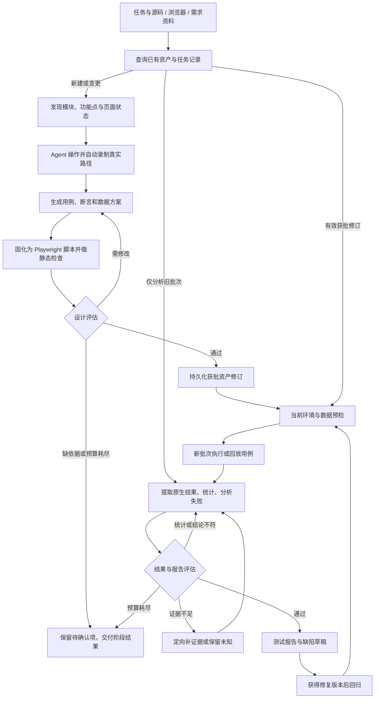

# UI 测试业务流程详细设计

更新：2026-10-21。状态：设计方案，尚未实现或对具体业务系统执行。本文作为[测试业务闭环设计](./测试业务闭环设计.md)的 UI 首期细化；具体实现顺序、任务依赖和完成标准统一以 [UI 测试能力实施计划书](./UI测试能力实施计划书.md) 为准。

自动录制前置、资产持久化、按需回放/续跑及 Skill 解耦详见 [UI 自动录制与资产复用设计](./UI自动录制与资产复用设计.md)。首次生成走完整评估流程；后续任务先查询有效资产，仅补做必要阶段。

## 1. 首期目标

测试工程师提供前端源码或可访问的页面，Agent 按“模块 → 功能点 → 场景 → 用例 → 断言”生成测试资产，经过独立评估后执行，再根据真实证据分析结果，通过第二轮独立评估交付报告。支持只有源码、只有页面、两者都有三种输入。

首期选择一个业务模块、一个测试环境、一个浏览器项目，先跑通核心成功路径及有明确依据的关键校验。不以自动抓取所有页面、生成最多用例或让全部测试变绿作为目标。

本方案有两个不同的通过条件：

- **设计评估通过**：用例和断言有依据、可执行、有检错能力，允许进入执行。并不表示产品会通过测试。
- **结果评估通过**：结果、统计和结论与证据一致，允许交付报告。即使产品存在失败，真实且完整的失败报告也可以通过评估。

独立 Agent 评估只能降低幻觉风险，不能保证零幻觉。事实来源、确定性检查、原始执行证据和可保留的“不确定”结论共同约束输出。

## 2. 整体流程与两个循环



补证据需要重跑时生成新 attempt 或新 run，保留原始失败，不直接改历史结果。若发现用例或脚本本身有问题，则生成新修订并返回设计评估，不能绕过第一道评估。

只有源码或已有测试导入时可跳过浏览器录制并保留草稿来源，不宣称已录制。仅录制任务在资产登记后结束；正式执行任务才进入预检和新批次。录制属于有操作边界的发现/设计活动，其证据不能替代正式执行结果。

## 3. 输入、发现与模块划分

### 3.1 三种输入模式

| 模式 | Agent 读取什么 | 能交付什么 | 必须说明的边界 |
|---|---|---|---|
| 只有源码 | 路由、菜单、页面组件、表单校验、权限判断、状态管理、请求调用、已有测试 | 模块图、候选场景、带来源的用例/断言草稿和脚本草稿 | 没有运行环境就不能验证定位器、页面可达性或实际执行 |
| 只有浏览器 | 导航结构、可访问性快照、DOM、表单、弹窗、交互状态、网络与控制台 | 已探查功能、场景、定位器及可运行脚本 | 只能覆盖当前角色、数据和状态能访问的内容；未发现不等于不存在 |
| 源码 + 浏览器 | 静态结构与实际页面互相映射 | 更完整的模块/功能清单，标出源码与部署差异 | 固定源码提交和部署版本；无法确认对应关系时不合并为同一事实 |

需求、验收标准和已确认业务规则是可选输入，但它们决定能否断言业务正确性。没有需求仍可做当前行为的回归基线、明确的 HTML/前端声明校验及探索性测试，报告必须标明性质。

### 3.2 源码发现

优先复用项目已有测试、路由元数据、表单 schema、test ID 和页面对象。Agent 先检索入口和依赖，再按选定模块读取，不全量灌入整个仓库。复杂静态结构需要解析时复用 TypeScript compiler API 或项目已有 AST 工具，不自建通用解析器。

提取的信息包括：页面路径、菜单归属、组件、可执行动作、前置状态、角色控制、输入约束、请求调用和已有断言。每项保存文件、符号/行号、源码版本；源码行号变化后不能继续把旧位置当最新依据。

共享组件归入实际业务页面，避免同一个搜索框因复用生成几十条等价用例。动态路由、特性开关和无法静态求值的权限标记为“待运行核验”。

### 3.3 浏览器发现

不是无差别点击所有元素。先使用页面快照和导航识别入口，再围绕选定功能探查必要状态：初始、输入后、展开/弹窗、提交后，以及有依据的校验状态。

每个已探查状态记录 URL、角色、数据引用、进入步骤、时间、部署版本（若可得）、页面证据及定位器候选。页面刷新后重新获取元素引用；MCP 快照中的临时 ref 不能直接保存为长期测试定位器。

只在指定站点、页面范围、角色和已授权数据操作内探查。提交、删除、退出、发通知等动作不能作为“抓元素”默认遍历；这些动作也可能产生真实副作用。设置页面/状态数量和时间上限，记录截断原因与未探索入口。

iframe、Shadow DOM、虚拟列表、分页、懒加载和文件上传按实际存在情况处理；canvas 或第三方不可访问内容可标记需视觉/人工补充，不凭截图猜坐标后声称语义验证通过。

### 3.4 模块与功能清单

采用 `module_id → feature_id → scenario_id → case_id → assertion_id` 的稳定映射。模块优先依据产品导航/路由和业务职责，不能简单把每个源码文件视为一个模块。

功能清单至少包含：模块、功能、入口/角色、可达状态、关键动作、资料来源、发现方式、优先级、覆盖状态、缺口。区分“源码发现”“页面已观察”“双方核对”“未确认”。

优先级依据用户关键任务、业务影响、变更范围和历史缺陷；没有这些信息时说明排序依据，不假装已知业务重要性。第一批生成选定主链及关键校验，待链路稳定后再扩展。

## 4. 自动生成用例和断言

### 4.1 用例生成规则

每个用例包含独立测试目的、模块/功能归属、来源、前置状态、角色、数据、步骤、对应断言、清理方式及依赖。用例尽量独立；一个业务链可包含多个相关步骤，不要求每个按钮一条 case。

默认场景按实际功能选择：成功主链、必填/格式/边界校验、查询与结果一致性、取消/返回、刷新后状态、权限可见性、重复操作。后几类只有在需求或声明支持时才产生确定预期。

空态、错误态、权限分支需要可构造的环境和数据。只发现代码分支但无法触发时，保留候选和阻塞条件，不伪造已经覆盖。

### 4.2 预期依据分级

| 依据类别 | 允许的结论 | 不允许的推断 |
|---|---|---|
| 需求、验收标准、用户确认规则 | 对指定规则的业务符合性验证 | 超出来源补造角色、错误码或业务限制 |
| 接口契约、HTML 属性、前端 schema 等明确声明 | 验证对应声明是否得到实现 | 前端声明自动等于业务规则正确 |
| 源码实现与当前页面行为 | 当前行为基线、版本间变化检测 | 实现与自己一致就等于业务正确 |
| Agent 推测 | 待确认问题或探索建议 | 自动成为正式业务断言 |

来源冲突先记录问题，不默认“文档永远正确”或“页面最新所以正确”。当前行为基线与业务验收结果分别统计；无法消除的歧义阻塞相关断言，不阻塞其他模块。

每条断言保存 `oracle_type`（需求验收 / 声明校验 / 行为基线）、`source_ref`、来源版本或摘要、适用角色与条件、预期值或独立计算规则。待确认推测不进入正式断言集合。录制截图只证明曾观察到该行为；若将其用于回归基线，必须显式标记其性质，评估通过也不能将它升级为业务正确性证明。

### 4.3 断言结构与强度

每条断言记录：`assertion_id`、关联步骤、检查对象、比较方式、期望值/计算规则、依据位置、观察时点/等待条件和证据要求。期望值在执行前固定，不从同一次页面结果中读取再原样比较。

| 检查层 | 示例方式 | 注意点 |
|---|---|---|
| 操作前提 | `toBeVisible`、`toBeEnabled`、定位唯一性 | 只能证明动作可以开始 |
| 即时反馈 | 明确的校验消息、弹窗状态、跳转 URL | 单独一个成功 toast 通常不足以证明核心业务完成 |
| 业务结果 | 指定业务键对应的字段、数量、状态、结果集合 | 校验真实目标对象，避免只检查任意一行存在 |
| 持久化/跨页面状态 | 刷新或重新进入后读取同一对象 | 仅在业务要求持久化时作为必需断言 |
| 负向结果 | 对应错误提示、目标未产生/未改变 | 定义完整动作及观察窗口，不能页面尚未加载就断言“不存在” |

派生期望根据固定输入和确认规则独立计算；金额、时间和排序明确单位、时区及规则。动态标识可从创建动作提取作为后续定位键，但不能因此省略结果校验。

**示例仅演示方法，不代表目标系统存在该功能：** 若需求明确“名称必填，保存后刷新仍保留”，则空名称用例验证输入错误及未创建记录；合法名称用例验证新记录的业务键/名称，并刷新后复查。生成器不能仅断言按钮可点击、toast 出现，也不能自行假设名称最多 20 字。

### 4.4 脚本固化与断言检错性

复用 Playwright Test 的 fixture、自动等待和 `expect`。定位优先可访问角色/label/test ID，合理限定容器；不自动使用 `.first()`、`force` 或固定延时掩盖重复定位和页面状态问题。

每条 case/断言对应明确测试标题和步骤标识。静态检查拒绝恒真断言、空测试、未等待的异步断言、吞掉异常的 catch，以及未经依据的 `skip`/`fixme`。`test --list` 仅证明测试可被发现，不证明运行正确。

设计评估还要求“这个断言会漏掉什么错误”：核心用例应能区分一个正确结果和一个合理的错误结果。必要时在隔离的脚本副本、组件测试或受控响应中加入错误字段/缺失记录，验证断言确实失败；不修改业务服务制造错误。这属于断言自检，单独保存，不能计入真实业务通过数。

视觉比较仅在有经确认基线且渲染环境可控时启用；首次截图不能自动充当已确认正确的视觉基线。

## 5. Loop A：用例、断言与脚本评估

### 5.1 角色与输入

生成角色可修改用例和测试脚本；评估角色只读审查。评估者使用独立上下文，读取原始需求/源码片段/页面证据、功能清单、候选修订和检查结果，不只阅读生成者的解释。

可使用同一模型，但不同角色仍可能有共同偏差，不能以“两名 Agent 同意”作为证据。独立子 Agent 不可用时用独立会话/评审阶段替代，并标明隔离程度。

### 5.2 通过规则

| 检查项 | 必须满足 |
|---|---|
| D1 覆盖 | 选定功能和主链有对应 case；漏项、未探索状态显式记录 |
| D2 依据 | 每条关键预期都有可核对来源；推测未混入业务断言 |
| D3 可执行 | 前置数据、角色、步骤和环境可实现；脚本与用例一致 |
| D4 断言质量 | 检查业务结果、明确对象和时机，不是恒真或只有操作成功 |
| D5 稳定性 | 定位、等待、隔离和清理合理；无随意放宽比较 |
| D6 完整性 | 无静默删 case、漏断言、重复计数；关键缺口可追踪 |

不以总分超过某阈值抵消重大问题。上述硬条件全部满足且没有阻断项才标记 `approved`；格式等建议可作为不阻断改进。

纯源码输入可以获得 `design-reviewed`（设计已审查），但没有环境和定位运行证据不能获得 `ready-to-run`。运行就绪还需依赖检查、可达页面及关键定位核验。

### 5.3 评估输出与循环规则

评估结果包含：候选版本/内容摘要、`approved / revise / blocked`、问题 ID、涉及 case/assertion、规则编号、来源证据、具体理由和修复验收条件。评估者指出问题，生成者修改；保留每轮版本和差异。

默认建议：每个模块最多 **3 次完整评估**（首次评估 + 最多两次修订评估），同时设置本轮任务的时间/调用预算。以下情况提前停止：

- 缺少需求、账号或环境等生成器无法补齐的事实 → `blocked`。
- 同一阻断问题连续两轮未改善 → 暂停该项，交付分歧与需要补充的信息。
- 超时、取消或预算耗尽 → 保留未通过状态，不自动放行。

在预算内持续生成—评估直到通过；上限是防止死循环，不是将“不通过”改成“通过”。已通过用例可形成独立执行集合，受阻用例留在总范围中并报告，不偷偷缩小覆盖分母。

每次修订重审受影响内容，并重新检查模块覆盖和跨 case 依赖。改变用例、断言、定位器、数据规则或脚本后，原评估不再自动适用；执行必须绑定获批的具体版本。

### 5.4 先验证评估规则能发现问题

为两个评估环节建立小型人工核对样本集，至少覆盖：无来源预期、恒真断言、只检查 toast、漏主链、脚本与用例不一致、错批次截图、缺执行实例、失败被写成通过、将 500 武断归因为数据库故障，以及对应的合理样本。每个样本标记应触发的规则、预期处理和依据；评估者不读取标准答案。

先用公开样本完善规则，再用保留样本验收。确定性门禁的无效批准、摘要变化和统计错误反例必须全部拦截；Agent 对关键错误样本须给出正确问题及来源，不能只输出“未通过”。同时检查合理样本能通过，避免靠拒绝所有候选达标。首版对关键样本至少独立重复 3 次，记录漏检、误拒、证据错引、修订轮数；任何关键漏检先修正规则再重验受影响样本。

这是 UI 测试流程自身的质量验收，不扩展成通用 Agent 测评平台。有限样本通过不代表零幻觉；模型、评估 Skill 或规则版本变化后，重新验证受影响样本，并登记版本及已知限制。

## 6. 执行 case 与保留证据

1. 固定执行计划：源码/部署版本、用例与脚本修订、输入数据、角色、浏览器项目、视口和执行器版本；核对实际选中的测试实例。
2. 检查依赖并准备可重建数据和独立浏览器上下文。首期按业务依赖串行，同一对象的有状态链放在同一 case 或显式依赖组。
3. 调用 Playwright Test 执行，复用项目现有 fixture 和 reporter。测试脚本/runner 决定断言结果，Agent 解释结果，不通过聊天宣告“执行成功”。
4. 保存每次 attempt 的原生结果、失败步骤、预期/实际、必要截图和 trace，以及相关网络/控制台证据。探查阶段执行记录与正式测试分开。
5. 结束、失败或取消后尝试清理本轮创建的数据；清理失败单列，不批量删除未知数据。取消未完成的测试记为取消，状态未知的外部操作先核对后续跑。

首期建议默认业务执行不自动重试；需要判断偶发问题时做一次隔离诊断复跑。沿用现有重试策略时保存所有尝试，首次失败后成功仍标记不稳定。脚本修改后的复跑是新修订，不能改写原来失败。

执行失败不直接进入“改到测试通过”的循环。先分类：产品问题形成缺陷；确有脚本问题才修订并回到 Loop A；环境问题恢复后在新批次执行。

内置报告能提供测试与步骤结果，但不保证每条成功断言都单独可见。关键断言应使用带 assertion_id 的 `test.step`/附件与 Playwright 自定义 reporter 接口补足映射；只增加最小证据适配，不自建测试执行器。业务代码权限、登录态和 trace 中的敏感信息按项目规定处理，报告只链接允许查看的证据。

## 7. 结果统计与失败分析

### 7.1 统计由确定性程序生成

从 Playwright 原生 JSON/JUnit 与冻结计划计算数字，Agent 不凭终端片段或自行心算汇总。建议保留原生状态及规范化业务状态两列，明确 failed、timedOut、interrupted、skipped、flaky 的映射；预期失败标记也必须披露，不能当稳定业务通过。

最小统计单位为 `case_id + revision + data_row_id + browser_project`；attempt 单列，不把重试当新用例。只有报告实际提供断言级记录时才统计断言数，不从测试数估算。

报告同时列出：候选数、评估通过/待修订/阻塞数、计划执行实例数、实际启动实例数，以及通过、失败、阻塞、跳过、取消、未执行、不稳定、状态未知。所有计划实例必须归入互斥的最终状态，无法核对时报告完整性评估失败。证据完整性作为另一维度统计：已知断言失败但缺少 trace 仍是失败，同时标记证据缺口；缺少执行结果无法判断时才使用状态未知，避免重复计数。

- 稳定通过率 = 稳定通过 /（稳定通过 + 失败 + 不稳定）；分母为 0 时不适用。
- 另列全部阻塞、跳过、未执行、取消和未知数，不能用通过率掩盖这些缺口。
- 功能覆盖按“已选功能点中有经评估用例的数量”和“已获得执行结论的数量”分别展示；它不是代码覆盖率，也不是全产品覆盖率。
- 按模块、功能、优先级汇总；需求验收、声明校验、行为基线分别列出，Mock/受控响应与真实服务结果分开。

### 7.2 失败原因分析

| 分类 | 可参考的证据 | 避免的误判 |
|---|---|---|
| 产品行为不符合预期 | 有效需求、失败断言、对应页面/网络结果 | 仅凭超时就认定后端 bug |
| 测试脚本问题 | 定位歧义、用例与脚本不一致、等待条件错误 | UI 出现缺陷时一律“自愈”选择器 |
| 测试数据问题 | 数据准备记录、归属冲突、前置状态不满足 | 将正常业务校验误报为产品故障 |
| 环境/认证/依赖问题 | 登录失效、服务不可达、部署/浏览器错误 | 直接归咎于产品业务代码 |
| 不稳定问题 | 同版、同数据条件下不同 attempt 的结果 | 重试成功就抹掉首次失败 |
| 依据冲突/证据不足 | 需求矛盾、截图/trace 缺失、版本不匹配 | 为了填报告而编造根因 |

分析顺序：核对前置条件和版本 → 找到第一个失败步骤 → 对照页面与请求时间线 → 检查数据/依赖 → 给出可支持的分类 → 必要时定向复现。共同依赖导致的多个失败可聚类，但保留每个用例结果。

每条分析分成 **观察事实、候选解释、支持证据、反证/替代解释、下一验证动作**。结论等级用“已证实 / 有证据支持的疑似 / 未知”，不输出虚假的精确置信百分比。例如收到 500 可证明请求失败，不能在没有服务端证据时确定是数据库死锁。

### 7.3 失败后的动作分流

| 判定 | 下一动作 | 必须保留的限制 |
|---|---|---|
| 用例、断言或脚本确有问题 | 新建资产修订，回到 Loop A；获批后新批次执行 | 不覆盖原失败，不为适配缺陷而降低原业务预期 |
| 缺需求或依据冲突 | 阻塞受影响断言，列出待补事实；继续独立用例 | 不自动选取有利于通过的解释 |
| 数据准备、环境或认证问题 | 修复对应前置条件，预检后新批次执行 | 资产未变且批准有效时不重新录制；数据规则改变须重审 |
| 有证据的产品失败 | 形成缺陷草稿，获得修复版本后回归 | 不自动改业务代码、不假称缺陷已提交或已修复 |
| 证据不足或疑似不稳定 | 定向补证据或隔离诊断复跑，仍不确定则保留未知 | 新证据关联新 attempt/run，原结果及尝试完整保留 |

每条处理记录关联原 run/case、分类依据、建议动作、执行条件和后续 run；处理建议不等于动作已经完成。

## 8. Loop B：执行结果、归因与报告评估

结果评估角色只读原始报告、冻结计划、脚本版本、需求依据、证据索引和分析草稿。先独立核对统计与失败，再检查分析者结论，减少被其解释引导。

必须核对以下 R1–R6 规则，评估记录使用对应编号：

1. 计划实例与原生结果能逐项对应，计数可重算，退出码和异常未被忽略。
2. 每个“通过”有实际执行且关键断言到达的依据；不能把工具调用成功、启动浏览器或某张截图当通过。
3. 每个失败、跳过、取消、重试及证据缺失均可见；截图/trace 属于正确 run/case/attempt，文件存在且能读取。
4. 失败分析引用的证据确实支持该结论；因果归因与观察事实区分，无法证明的根因保留未知。
5. 报告范围与实际覆盖一致；有限模块、单角色测试不外推全产品质量。
6. 缺陷、阻塞、残留数据和回归建议可追溯；报告不暗示问题已修复或已提交外部工单。

不通过时按问题分流：计数错误重新解析；结论过强改写为证据支持的范围；证据不足在授权内定向补取/复跑。没有条件补证据时可发布明确标记“不完整/无法判断”的阶段报告，但不能标记完整性已通过。单纯根因未知不阻止交付真实失败报告。

默认同样最多 3 次评估；根因可保持未知，不要求为获得评估通过而猜出答案。评估修订不得改原生运行文件、删除失败或修改历史统计分母。

正式报告内容：范围与版本、模块/功能覆盖、设计评估结论、执行统计、关键失败及证据、归因等级、评估未解决项、未覆盖风险、清理情况和下一步回归集合。附上结果评估结论和所评估报告版本。

## 9. Agent 与成熟能力分工

选型与实现必须遵守 [实施计划书的成熟能力优先约束](./UI测试能力实施计划书.md#21-成熟能力优先与最小自建约束)：先盘点项目及 Pi 原生能力，再选择成熟扩展、包、Skills、MCP 和现成项目，最后仅补必要的规则与薄适配。允许主动联网搜索官方文档及公开项目，记录来源/版本并验证兼容性；不得未经调查重复开发浏览器控制、测试执行、报告或调度能力。已有有效选型证据可复用。

需要开发结果展示等界面时，优先复用现有组件或与当前技术栈兼容的成熟组件库；不因接入组件库扩大 P0 范围或迁移前端框架。通用组件负责交互，业务用例、执行证据和报告评估仍遵守本文规则。

| 职责 | 优先复用 | 增补的最小规则 |
|---|---|---|
| 源码/页面发现与测试计划 | 项目现有资产、Playwright 官方 planner 方法、Playwright MCP | 模块/功能归属、来源分级、探索范围 |
| 脚本和断言生成 | Playwright 官方 generator 方法、Playwright Test | assertion_id、独立预期、版本绑定 |
| 设计评估 | 独立只读 QA reviewer 角色 | 本文 Loop A 规则与逐项评估输出 |
| 执行与取证 | Playwright Test runner、fixture、reporter、trace | 最小结果/证据映射，确定性统计 |
| 失败分析 | Playwright 调试能力、healer 的调查方法 | 只修有证据的脚本问题，保留业务断言 |
| 结果评估 | 独立只读 evidence reviewer 角色 | 本文 Loop B 规则，结论逐项关联证据 |
| 调度 | 经验证兼容的 Pi package / 原生 Agent 能力 | 任务阶段、预算和结果交接，不自建执行循环 |

本轮确认项目安装的 Playwright 1.62.1 中已有 planner/generator/healer 模板。它们是成熟方法参考，不代表 Pi 可直接加载对应 Agent 定义：其工具名与通用 `@playwright/mcp` 并非完全相同，接入时需核对实际工具发现结果，不能将 `planner_setup_page` 等测试 MCP 工具当通用浏览器 MCP 自带能力。

官方 healer 模板允许调整预期、持续失败时标记 `fixme`；本工作流不沿用这些规则。限制到有证据的定位、等待、fixture 修复，保留原有业务预期；任何改动重新通过设计评估。模板中的模型字段也不直接照搬，沿用当前允许的模型配置。

生成器和评估器使用不同上下文和文件权限。建议主 Agent 调度、一个生成/执行子 Agent、一个只读评估子 Agent，按阶段复用角色；源码分析与页面发现、互不干扰的模块可并行。不要为每条 case 启动一个 Agent；批量 case 交给 Playwright worker，在账号/数据隔离后控制并发。

`pi-subagents` 的桌面兼容性和内部子会话架构仍按总体设计作为待核对项。首期也可由现有主 Agent 分阶段调用工具完成；不能把单上下文自审宣传为独立评估。无需为了设计落地再开发浏览器 MCP、HTTP 客户端、通用工作流引擎或报告服务。

## 10. 最小产物与版本关系

以下是原有单次任务的产物视图；持久化实现采用[资产复用设计](./UI自动录制与资产复用设计.md#52-首期存储方案)的 recordings/assets/tasks/runs 分层，将用例、测试与设计评估放入同一不可变资产修订。不同时维护两套权威存储。以下约定不是已安装的新执行协议：

```text
qa/ui/
  scope.md                         # 范围、角色、版本、依据和执行边界
  inventory.json                   # 模块/功能/状态及来源、未探索项
  cases.json                       # 用例、断言、数据规则、修订
  tests/                           # 可复用 Playwright 测试
  reviews/design/<revision>.json    # 设计评估与问题关闭记录
  runs/<run-id>/
    manifest.json                  # 获批版本、选择集合、环境和执行信息
    raw/                           # 原生报告及各 attempt 证据
    results.json                   # 可重算统计与 case/断言/证据映射
    analysis.md                    # 事实、候选原因、证据和未知项
    review.json                    # 结果评估与报告版本
    report.md                      # 最终或阶段报告
```

评估和执行绑定内容摘要/版本；同一路径内容被改动不能继续使用旧批准结果。来源、用例、断言、脚本、运行、证据和报告可双向追溯，避免“报告引用了旧截图”。首版用文件和现有版本控制即可。

## 11. 用户可直接发起的任务模板

```text
请优先完成 [模块/功能范围] 的 UI 测试闭环。
源码：[路径，可选]；页面：[测试地址，可选]；部署/源码版本：[已知信息]。
需求与已有测试：[位置，可选]；角色/凭据引用：[引用]；允许的数据操作：[范围]。

先查询已有资产、评估和任务记录，选择本次需要的能力；有效脚本不重新录制。
首次需要生成时，按模块和功能点分析源码、自动操作并录制页面路径、保存来源。
只有当前行为依据的预期标为行为基线；未知业务规则保留待确认。
优先生成核心主链用例和对应断言，
沉淀为 Playwright 测试，复用已有 fixture、定位器和报告能力。

生成后安排独立评估：检查覆盖、依据、可执行性、断言检错能力和脚本一致性。
发现问题则修订并再次评估，最多 3 次评估；缺事实或连续无改善时保留阻塞。
只有获批且运行就绪的版本进入执行，其他候选仍计入范围缺口。
将录制、获批资产、评估和任务阶段持久化；仅录制任务到此结束。
回放或续跑复用有效修订，补做当前环境/数据预检，不复用旧执行的通过结论。

使用 Playwright Test 执行并保存每次尝试的真实报告和关键证据，自动统计结果。
分析失败时分别列出事实、推测和未知，不为获得通过而放宽断言或跳过测试。
再安排独立评估核对原始结果、统计、归因和报告；不通过则纠正或定向补证据，
最多 3 次评估。证据无法补齐时给出有明确缺口的阶段报告。

输出模块覆盖、用例/断言、两轮评估记录、运行报告、失败原因、缺陷草稿和回归建议。
允许按独立模块并行，但不要共享正在操作的浏览器和可变业务数据。
沿用已有授权；不修改被测系统业务代码，不自动发布外部报告。
```

## 12. 实施优先级与验收

下表为业务里程碑概览；编码顺序以 [实施计划书](./UI测试能力实施计划书.md) 的任务 ID 与依赖为准。先完成兼容性验证和最小存储契约，再交付下面的业务能力。

| 阶段 | 交付 | 验收重点 |
|---|---|---|
| P0-1 录制与设计 | 资产查重、源码/页面输入、自动录制、模块清单、用例/断言、Loop A | 真实操作可追溯；独立评估能拦截无依据预期、不可复跑脚本、空断言及漏主链 |
| P0-2 持久化与执行 | 获批资产与任务阶段存储、按需 Skill 组合、runner、逐实例结果与统计 | 重开可复用资产；有效修订无需重录；真实执行、计划对账、原始失败和重试保留 |
| P0-3 分析与交付 | 失败分析、Loop B、最终报告和回归入口 | 不把超时猜成根因，不把缺证据记为通过，失败报告也可正常交付 |
| P1 维护 | 中断核对、续跑与失败重跑、变更影响选择、资产迁移 | 在完整 P0 闭环可重复运行后完善，不重复未知业务写入 |
| P2 扩展 | 多模块并行、多角色/浏览器、视觉基线 | 依据实际需求接入，不降低原有评估要求 |

未来验证该工作流时，除真实主链外，用隔离评估样本检查：无来源断言被退回；同一缺口不会无限循环；原生失败不被总结为通过；缺失实例/错批次证据被识别；首次失败后重试成功保持不稳定；产品失败不会触发放宽预期；仅源码输入不会伪造浏览器执行。这些是计划验收项，本次未执行。

首个可用版本的完成标准是：选定模块形成可追溯用例与断言，经设计评估后实际执行，原生结果被准确统计，失败分析与报告经证据评估，资产可用于下次回归。接口专项测试及接口/UI 联动后续再接入，UI 首期不依赖 Postman。

## 13. 参考依据与本次验证范围

- [总体闭环设计](./测试业务闭环设计.md)、[Pi 扩展使用指南](./Pi扩展使用指南.md)：当前客户端接入范围及多 Agent 兼容限制。
- [Playwright 官方 Test Agents](https://playwright.dev/docs/test-agents)、[Playwright MCP](https://github.com/microsoft/playwright-mcp)、[断言](https://playwright.dev/docs/test-assertions)、[Trace Viewer](https://playwright.dev/docs/trace-viewer)：选型参考。
- 本轮实际阅读本项目 `node_modules/playwright/lib/agents/` 的 planner/generator/healer 和 coverage 模板，以及上一轮获取的官方 MCP README；工具和模板需在落地时按锁定版本复核。
- 本次仅优化设计、同步总体方案和文档索引，检查本地链接、格式及内容一致性；未安装能力、调用业务浏览器、运行用例或证明评估 Agent 已有效降低幻觉。
