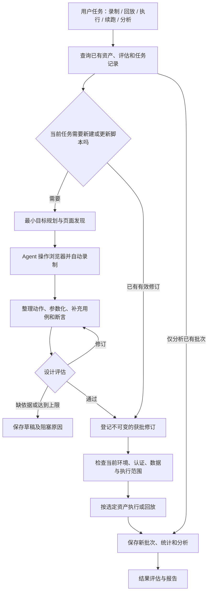

# UI 自动录制、持久化与能力组合设计

更新：2026-10-21。状态：设计方案，尚未创建本文命名的 Skills、执行脚本或持久化实现。本设计补充 [UI 测试业务流程详细设计](./UI测试业务流程详细设计.md)，保留执行前设计评估和执行后证据评估两个循环。

## 1. 本次扩展的目标

首次任务由 Agent 根据测试目标自动探索页面、操作和录制，生成带断言的可复跑脚本，经过设计评估后登记为可执行资产。后续任务可以直接选择资产回放、回归失败用例、继续未完成任务或重新分析历史结果，不必每次从发现功能开始。

Agent 依据任务和已有资产选择能力；确定性脚本负责验证前置条件、读写资产、启动执行器和整理结果。能力之间通过有版本的产物引用交接，避免依赖聊天全文、全局浏览器变量或彼此的内部实现。

**复用脚本和评估，不复用“本次测试通过”的结论。** 新执行创建新批次；查看旧报告则明确沿用旧环境、时间和版本。

## 2. 工作流入口先判断“已有资产能否复用”



自动录制位于正式执行之前，但仍需要最小目标和操作边界。没有目标的全站点击容易重复、遗漏和产生副作用。录制中的浏览器动作是真实操作，设计评估不提供事后的操作授权；必须先在已授权测试环境、账号和数据范围内录制。

“仅录制”任务在评估通过并登记资产后结束，不隐含授权继续正式执行。评估后的脚本若仍需环境依赖，则登记为设计通过但未就绪；不得伪装已可运行。

## 3. 自动录制如何工作

### 3.1 录制模式与工具选择

| 模式 | 用途 | 实现路径与边界 |
|---|---|---|
| 自动目标录制（首选） | 用户描述业务目标，Agent 自行完成对应交互 | 复用 Playwright 官方 generator 方法及测试 MCP 的操作日志能力；先核实实际工具与配置 |
| 常规 MCP 辅助录制 | 当前只有通用 Playwright MCP | Agent 操作真实页面，保存调用/观察记录，再生成 Playwright Test 草稿；需补最小记录适配，不能假称通用 MCP 自带完整 recorder |
| 人工示范补充 | 验证码、复杂控件、Agent 无法可靠发现的路径 | 人处理必要步骤，使用 Playwright codegen 或接续录制；不要求人工完成整条主链 |
| 导入已有脚本 | 团队已经维护可用测试 | 跳过录制，对现有脚本建立用例/断言映射并评估；保持原框架和 fixture |

项目现有 Playwright 的测试 MCP 提供 `generator_setup_page`、`generator_read_log`、`generator_write_test`。生成器先根据计划实际操作页面，再读取日志并写脚本；日志不是自动正确的测试代码，写文件成功也不是设计评估通过。上述工具不属于所有通用 `@playwright/mcp` 实例，接入时以工具发现为准。

优先选择一个合适的浏览器后端并复用其上下文，不让两个 MCP 同时控制同一浏览器。测试 MCP 工具的 `readOnly` 标记不能代替副作用判断，例如 setup 可执行 seed，write_test 实际写文件。按实际动作设置能力权限。

首期先验证测试 MCP 能在当前 Pi 客户端完成工具发现、真实操作、读取动作日志及生成脚本，并锁定验证过的版本和启动配置。验证不通过时记录具体差距，再选择一个能满足相同验收条件的替代路径；不同时开发测试 MCP、通用 MCP、CLI 三套接入。常规 MCP 与人工示范是替代/补充方案，不是首期全部实现项。

### 3.2 自动录制步骤

1. **查重与计划**：按项目、模块、功能、场景和角色查找已有资产；缺什么才录什么。确定入口、目标完成条件、已允许动作、时间/步骤上限。
2. **准备上下文**：检查测试站点、登录状态和初始数据，创建独立浏览器上下文及 `recording_id`。与其他任务隔离。
3. **执行与记录**：Agent 根据源码/可访问性快照选择动作，记录动作参数引用、语义定位器、动作前后观察、时间和相关证据。敏感输入只记凭据引用。
4. **检测进展**：记录页面状态变化和目标里程碑；重复进入同一状态且无进展时停止该分支，不无限点击。找不到元素先更新快照，不凭旧 ref 猜测。
5. **整理草稿**：保留原始记录，另存整理后的成功路径。探索失败和已发生的数据操作另列，不能因删去草稿中的探索步骤而丢失清理记录。
6. **形成可复用测试**：从真实动作生成代码，替换临时 ref，参数化地址、角色和数据；关联模块、功能、case 和断言。创建的数据标识在每次执行时重新获得，不硬编码录制时 ID。
7. **设计评估**：按原 Loop A 规则评估；不通过返回修订，必要时仅重录受影响片段。通过后冻结资产修订，再根据任务意图进入执行或结束。

录制结束时至少交付：原始动作记录、模块/功能映射、整理后的脚本、前置/清理规则、断言依据、未探索项和评估记录。浏览器轨迹或视频只用作证据，不作为唯一可执行资产。

### 3.3 自动录制的附加评估条件

在 D1–D6 基础上增加以下规则：

- **D7 动作真实性**：录制来源步骤能对应实际观察与工具记录；推导补充的动作单独标记并验证，不能假称全部录制所得。
- **D8 可复跑性**：无过期 ref、固定临时 ID、录制者个人路径或硬编码凭据；地址、数据、角色和清理方式明确，独立环境状态可重建。
- **D9 断言完整性**：录制产生的点击/输入不是业务断言；预期仍从需求、明确声明或标记过的行为基线取得。不能把录制时看到的值自动认定正确。
- **D10 变更与副作用**：整理探索路径没有遗漏数据归属，重放不会意外重复下单、发通知或删除旧数据；共享 fixture 及调用依赖包含在评估范围。

评估前允许在隔离数据上做受限的定位/脚本验证，标为“录制或设计验证”，不能计入正式测试通过数。只有设计通过后，才能作为获批资产进入正式回放/执行。验证本身也必须有当前操作范围授权。

### 3.4 录制完成不以“点击到了终点”为标准

进入设计评估前检查五项：初始状态可重建；录制数据可替换；定位器能脱离临时浏览器 ref；关键业务结果有带来源的断言；已创建数据有清理或保留归属。缺项记录为未完成或待修订，不把动作日志直接登记成获批脚本。

评估通过后的首次正式执行必须使用新的浏览器上下文和重新准备的数据，从声明的初始状态开始。可复用经核验的认证引用，不能沿用录制留下的页面内存或成功后的业务对象。只有这次独立执行才证明脚本可从初始状态运行；其业务断言仍可能真实失败。

## 4. 将“回放”分清楚

| 用户意图 | 系统行为 | 是否产生新业务动作 |
|---|---|---|
| 查看录制过程或旧 trace | 打开已有证据，显示原批次信息 | 否，不调用测试执行器 |
| 可视化回放脚本 | 使用获批修订，以 headed 模式等方式重新执行，保留断言 | 是，新 run；不能只看动画判成功 |
| 执行回归 | 使用获批修订运行选定测试集合 | 是，新 run，记录实际结果 |
| 分析旧失败原因 | 只读取指定批次结果和证据 | 否；需要复现时单独登记诊断执行 |

用户只说“回放”且上下文不能判断时，先列出已有资产/记录，再澄清是查看证据还是重新操作系统，不能默认产生业务写入。

## 5. 持久化：分开保存资产、任务和执行

### 5.1 数据对象

| 对象 | 最小内容 | 生命周期 |
|---|---|---|
| 项目/范围 | 项目标识、环境引用、角色、允许操作、需求/部署版本 | 随确认范围修订；不是永久通用授权 |
| 录制 | recording_id、目标、操作记录、起止状态、数据归属、证据 | 原始记录保留；失败或中断也保存 |
| 测试资产 | asset_id、模块/功能/case、脚本、断言、fixture/数据规则及依赖摘要 | 稳定 ID，多份不可变 revision |
| 设计评估 | review_id、所评 revision/摘要、依据/评估规则版本、结论与问题 | 仅对绑定内容有效；旧记录保留 |
| 任务 | task_id、用户意图、选择资产、阶段状态、预算、阻塞、产物引用 | 跨会话恢复；不等于浏览器进程快照 |
| 执行批次 | run_id、task_id、固定修订、环境/数据、实例、attempt、状态和实际命令 | 每次执行新建；终态追加结果，不覆盖旧批次 |
| 分析与报告 | 原始结果引用、分析修订、结果评估和报告 | 可对同一批次重新分析，不重新执行 |

资产状态、任务状态和测试结果分开存储。“设计通过”不等于“测试通过”，“任务完成”可以伴随测试失败，不能共用一个 success 字段。

### 5.2 首期存储方案

首期采用项目本地文件，复用 Git、JSON Schema 校验和已有文件锁库；单机阶段无需先建数据库服务。增加 SQLite 是未来多进程写入/查询负载明确后的选项，不与文件同时建立两份权威状态。

```text
qa/ui/
  catalog.json                         # 可重建索引，按模块/功能检索资产
  recordings/<recording-id>/            # 动作日志、证据和整理前草稿
  assets/<asset-id>/revisions/<rev>/
    manifest.json                      # 状态、来源、依赖摘要和内容摘要
    cases.json                         # 用例/断言/数据规则
    tests/                             # 脚本及必要的共享依赖快照
    design-review.json                 # 绑定当前修订的评估结果
  tasks/<task-id>/manifest.json         # 阶段进度、执行意图和恢复信息
  runs/<run-id>/                        # 原生结果、证据、分析和结果评估
```

`catalog.json` 只作索引，权威信息来自各资产/任务/批次 manifest。启动时可扫描重建索引；索引缺失不能导致重新录制全部资产。Git 用于可维护脚本和设计资料的版本记录，不能替代未提交任务的持久化。运行证据、凭据、认证状态、锁和临时目录按项目策略排除出版本控制。

写入约定：单个对象加锁；使用唯一 ID/修订目录，先写临时文件，再原子替换 manifest；多文件产物完成且摘要核对成功后最后写完成标记。索引在对象提交后更新。进程崩溃留下的半成品标为 incomplete，不可进入执行。首期由主协调者登记资产和任务元数据，子 Agent 只交付各自目录中的产物。

执行批次先登记再启动进程，返回 run_id 后跟踪它；重复投递同一任务启动请求时查找已有批次和进程状态，不直接再启动。此处减少本地重复调度，不能承诺浏览器操作对远端业务“恰好执行一次”。

定义保留期与空间阈值：仍被资产评估、未结缺陷或活跃任务引用的证据不自动清除。已过期的历史证据保留缺失标记，不能给出无法验证的完整证据结论。认证状态单独私有存储，仅保存引用，读取时检查身份和有效性。

上述文件是测试业务资产与执行记录，不替代 Pi `SessionManager` 管理的会话 JSONL。测试包迁移时保留脚本、fixture/helper、依赖版本、配置模板、数据规则和来源摘要；运行环境地址及凭据通过引用绑定。复制到另一个允许的工作目录后，不能再依赖原 Skill 安装目录或开发者个人绝对路径。

### 5.3 复用与失效规则

| 变化/请求 | 可以复用 | 必须补做 |
|---|---|---|
| 同修订再执行或可视化回放 | 录制、用例、脚本、有效设计评估 | 当前环境/认证/数据预检、新批次执行、结果评估 |
| 只查看旧报告 | 原结果和报告 | 文件存在性与版本范围提示；不启动浏览器 |
| 对旧结果重新分析 | 原始结果和证据 | 新分析修订、结果评估；缺证据则明确缺口 |
| 仅登录态过期 | 测试资产和设计评估 | 刷新认证、验证角色；不用重录整条业务 |
| 换同一约定范围内的数据行 | 数据参数化的已评脚本 | 校验数据规则和前置条件、再执行 |
| 改脚本、定位器、断言、fixture 或数据规则 | 不受影响的独立资产 | 新 revision、重审受影响资产及依赖后执行 |
| 需求、角色规则或评估标准变化 | 仍成立的发现证据 | 定向影响分析、必要修订/重审；无法判定时阻塞相关资产 |
| 目标系统新部署 | 原测试作为回归基线 | 环境/依赖预检并执行；不要仅因版本更新就重录或将旧预期改成新行为 |
| 浏览器/执行器升级 | 可兼容的脚本 | 兼容预检；行为或脚本需改动时重审，不能把新版本工具与旧证据混用 |
| 来源范围不明确或内容摘要不匹配 | 可供参考的旧资料 | 查清依赖或标记过期；不能跳过评估 |

评估摘要覆盖用例、脚本、断言、共享 helper/fixture、配置和数据生成规则，不能只哈希主脚本。新增数据值按已评规则检查；更换规则属于修订。依赖关系不完整时不声称精确增量，只对无法排除影响的资产补评估，不机械重跑全部流程。

### 5.4 测试数据生命周期

每次录制或执行都登记数据记录：`data_id`、`owner_task_id`、`recording_id/run_id`、业务键、创建方式/fixture 版本、环境与角色、创建时间、过期时间、是否共享、清理方法、清理状态及证据引用。清理状态区分待清理、已清理、清理失败、按约定保留；到期仅产生待处理项，不据此删除归属未知的数据。

准备阶段检查前置状态，执行阶段记录实际生成的对象标识，结束/失败/取消阶段尝试按归属清理。清理失败不改写业务断言结果，但报告必须显示残留、影响和后续动作。录制期间创建的数据同样登记，不能只清理正式 run 的数据。

每个 run 使用独立命名空间、账号或业务键；不能隔离的资源标为共享并串行使用。已有 fixture 或项目允许的数据准备接口可以复用，这不意味着提前建设接口测试平台。只用 UI 准备数据也可行，须如实计入耗时和失败来源。

## 6. 任务恢复：从完成阶段继续，不能盲目从点击中间继续

支持以下粒度的恢复：已完成录制可直接评估；评估通过可直接预检执行；执行完成可直接统计分析；统计完成可直接结果评估。阶段输入摘要一致且产物完整时跳过已完成阶段。

录制中断保留动作和业务数据日志，恢复时重新验证当前页面/身份/数据状态，必要时从安全入口重新开始该片段。Playwright 浏览器进程、页面句柄、临时 ref 和 JS 内存不持久化为可靠检查点。

执行中断按 case/业务链边界恢复：已经完成的实例保留，未启动实例可继续；执行过写操作但无明确结果的实例先查询业务键和归属记录。无法判断时标记“需要核对”，不得直接重放写入。清理已发生时需重建数据，不能从失效检查点续跑。

续跑记录新的 run_id 并引用 parent_run_id，列出选择的剩余实例、仍适用的原输入版本和环境。跨部署版本默认分开报告，不能将不同版本结果拼成“本版本全部通过”。“只重跑失败用例”也保留原失败，不能作为覆盖整个原计划的单独全绿报告。

应用重启后先核对原进程/任务状态，区分活跃、结束和未知。PID 单独不足以证明同一个任务仍在运行。首期不承诺桌面关闭后自动后台续跑，恢复由用户任务触发，沿用 Pi 现有生命周期能力。

| 执行意图 | 选择集合 | 初始状态与记录 |
|---|---|---|
| 继续未完成任务 | 原计划中未启动的实例；状态不明实例先核对 | 新 run 引用父 run；按 case/业务链重建前置状态，不能按点击序号恢复 |
| 只重跑失败项 | 明确选择的失败/不稳定实例及必要依赖 | 新 run 保留原失败关联；默认不混入未执行项，依赖补跑另列 |
| 全量重新执行 | 本次确认的完整计划 | 全部重建数据和上下文；历史通过也实际执行一次 |

选择集合、包含依赖、排除原因、父批次和环境版本在启动前冻结。整条有状态业务链作为恢复单元时，可以重跑已完成的准备步骤，但须确认不会重复产生未知副作用。

## 7. 将能力拆成 Skills、脚本和工具

### 7.1 拆分原则

- **Skill** 描述何时使用、读哪些依据、如何判断和输出什么；按需加载正文。
- **确定性脚本** 做校验、资产读写、依赖检查、启动 runner 和统计，不调用大模型决定业务预期。
- **MCP/执行器** 操作浏览器和运行测试；优先复用 Playwright。
- **Pi package** 负责分发 Skills、模板及必要的薄工具扩展；不是新建一个 Agent 引擎。
- **Agent** 判断当前任务需要哪些能力，组织交接和评估；实际脚本校验执行前置条件，不能单靠提示词保证门禁。

### 7.2 建议能力目录

以下是待实现名称，不是当前已安装命令或 Skill。

| Skill | 触发条件 | 输入 → 输出 | 复用能力 |
|---|---|---|---|
| `ui-test-workflow` | 用户提出 UI 工作流任务，或恢复任务 | 意图、资产索引、task → 本轮执行计划/交接 | Pi 资源发现、产物引用；只加载必要技能 |
| `ui-discover-record` | 无合适资产、要求录制或局部补录 | 范围、目标、源码/页面 → inventory、recording、脚本草稿 | Playwright planner/generator 与浏览器 MCP |
| `ui-case-design` | 录制草稿需补用例/断言，或需修订 | 来源、录制/已有测试 → case/断言/脚本候选 | 官方 generator 方法、项目已有测试 |
| `ui-design-review` | 新修订或既有评估已失效 | 候选修订、原始来源 → 结构化评估 | D1–D10；独立只读评估角色 |
| `ui-test-run` | 正式执行、可视化回放、失败回归 | 获批资产、环境、数据 → run_id、原生报告 | Playwright Test；前置检查由脚本强制 |
| `ui-result-analysis` | 已有执行结果需统计和归因 | run、原始证据 → 确定性统计、分析/报告草稿 | 原生 reporter、trace、定位调试 |
| `ui-result-review` | 交付报告或重新分析后 | 计划、原生结果、报告 → 结果评估及正式/阶段结论 | R1–R6；独立只读证据复核 |

资产存取和任务恢复是共享的确定性基础操作，无需再为每个文件动作创建 Skill。首期可用一个命令入口和三个职责模块：资产/任务存储、执行预检与 runner 调用、结果解析。职责独立但不强行拆成多个服务或几十个脚本。

建议将能力打包为一个项目自有 Pi package，里面放上述 Skills、引用规则和薄脚本；名称在实施时确定。复用既有 Skill 时保持其来源，不复制整套官方代码。测试资产写在被测项目，不能写入只读技能安装目录；资产不依赖某一版技能目录的绝对路径。

### 7.3 能力调用约定

共享输入使用小型、版本化的 JSON 引用：`schema_version`、project/task/run/asset ID、revision、输入文件/摘要、范围和预算；不传全量会话历史，不在参数中传秘密值。一个能力可以独立运行，输出可供人工查看。

输出统一表达阶段状态、产物引用、摘要、问题列表、错误类别和可恢复性。Skill/脚本状态与 case 结果分开：测试失败是有效测试结果；格式错误、认证缺失、执行器崩溃另列，保留 runner 原始退出码。

使用现成 JSON Schema 校验器检查结构、引用完整性及版本，不自建格式解析框架。确定性校验保证结构与状态一致性，不能替代语义评估。角色、产物路径、调用者和评估记录需可追溯；主 Agent 不能凭文本“评估已通过”自行伪造 reviewer 结果。

能力目录另列 `capability_id/version`、输入/输出 schema 版本、所需工具及兼容版本、实际副作用、错误类别和是否可安全重复调用。未知 schema 主版本直接返回不兼容；兼容的小版本按声明读取，不静默丢弃必需字段。先验证引用存在、摘要匹配和权限范围，再调用工具。

首期固定错误类别即可覆盖：输入无效、版本不兼容、能力缺失、前置条件不满足、评估拒绝、运行器异常、证据不足、取消。错误输出携带已完成的产物引用及建议恢复阶段。是否重试由任务意图和副作用状态决定，不能仅因 `retryable` 就重复提交业务操作。契约只约束交接，不建设通用插件协议或新的 Agent 循环。

## 8. Agent 按需组合能力，但不能跳过执行门禁

任务入口先读取简短能力目录与现有资产索引，Agent 再加载相关 Skill。调用前核对能力是否真正加载、所需 MCP 工具是否可用、脚本是否存在。能力不足就保存具体阻塞，不能以普通聊天模拟录制或执行。

| 用户任务 | 需要加载的能力 | 不必重复做的工作 |
|---|---|---|
| “自动录制这个模块并保存” | discover-record → case-design → design-review | 无需正式执行/结果分析，除明确要求的设计验证 |
| “回放这份已通过评估的脚本” | test-run → result-analysis → result-review | 有效资产不重新探索、录制、生成或完整设计评估 |
| “重新运行这批失败 case” | 读取原 run → test-run → result-analysis → result-review | 用例未变且批准有效时不重新生成 |
| “分析昨天失败的原因” | result-analysis → result-review | 默认不重录、不启动浏览器、不产生新测试动作 |
| “继续上次任务” | workflow 读取 checkpoint → 加载未完成阶段所需能力 | 已完成且有效阶段不重复执行 |
| “页面改版，更新受影响的脚本” | 定向 discover-record/design → design-review → 后续执行（按授权） | 无关资产不重录 |

正式执行脚本必须验证：指定 revision 与依赖摘要匹配、设计评估适用、无阻断问题、环境/角色/数据范围匹配、授权覆盖实际动作、没有同任务重复活跃 run。未满足则返回结构化阻塞，即使 Agent 错选了执行能力也不继续。

该检查只保护工作流提供的执行入口，不是通用安全沙箱。具有直接 shell/MCP 写入能力的其他调用路径不能靠 Skill 隔离；部署时应按角色提供实际所需工具，评估者不持有启动正式执行和改写原始证据的能力。已有授权持续适用；范围变化才需要补齐信息。

## 9. 实施顺序与验收

本节描述交付能力；实际开发按 [UI 测试能力实施计划书](./UI测试能力实施计划书.md) 执行。实施计划是唯一任务排序和进度登记入口，下表的能力分组不代表编码顺序。

| 能力分组 | 实施内容 | 可验证结果 |
|---|---|---|
| 1 | 录制 → 补断言 → 设计评估 → 登记资产 | 给定目标后 Agent 完成真实交互、生成可读脚本，未获批脚本不能正式执行 |
| 2 | 资产存取、任务阶段持久化、执行预检 | 退出重开后能找到原资产和评估；二次执行不触发重新录制，产生新 run |
| 3 | 按需 Skill 组合、执行/分析/评估解耦 | 单独录制、执行、分析、续跑均有对应最小路径；既有两个评估循环保留 |
| 4 | 多模块复用与并行 | 依赖变更只使相关资产失效；数据隔离、单写者登记和重复调度检测有效 |

首期必须演练：

- 无任何资产时录制新主链；已有脚本时导入并评估，不重复造同一脚本。
- 设计被拒绝时不能正式回放；篡改脚本或共享 fixture 后旧批准失效。
- 第二次执行直接复用资产但重新检查环境，旧通过记录不算新执行证据。
- 只查看 trace 或分析旧 run 时不启动业务操作；历史缺证据时如实报告。
- 写入中断后识别 incomplete；索引损坏可重建，未完成任务可找回。
- 写业务动作后断网/崩溃，恢复先核对状态，不自动重复提交。
- 登录态过期只恢复认证；需求变化定向重审；新部署按旧用例回归而不是迎合新行为。
- 技能缺失、MCP 不可用、版本不兼容均输出具体阻塞，任务不伪装成功。

效率也用真实记录验收：记录首次获批资产耗时、人工接管次数及耗时、录制/评估轮数、再次执行是否发生重录、复用资产数量和各阶段耗时。与相同范围的人工操作基线比较；不能仅因使用自动录制就声称效率已提高。资产复用率与测试通过率分别统计，不为提高复用率继续运行已失效脚本。

本次完成上述流程、存储和能力边界设计；没有安装 Skills/package、改变客户端架构或运行录制。未来实现使用具体项目与授权范围验收，不能以设计文档作为已交付功能证明。

## 10. 依据

- [UI 详细设计](./UI测试业务流程详细设计.md)：用例/断言来源、两个评估循环、统计规则。
- [Pi 扩展使用指南](./Pi扩展使用指南.md)：技能按需读取、包分发、原生 MCP 以及客户端生命周期限制。
- [Playwright Test Agents](https://playwright.dev/docs/test-agents)、[Codegen](https://playwright.dev/docs/codegen)、[认证状态](https://playwright.dev/docs/auth)：成熟能力选型参考。
- 本轮实际阅读项目安装版 `playwright/lib/mcp/test/generatorTools.js` 和 generator 模板，核对 setup、日志获取与文件生成边界；未验证其在当前 Pi 客户端中的完整接入。
