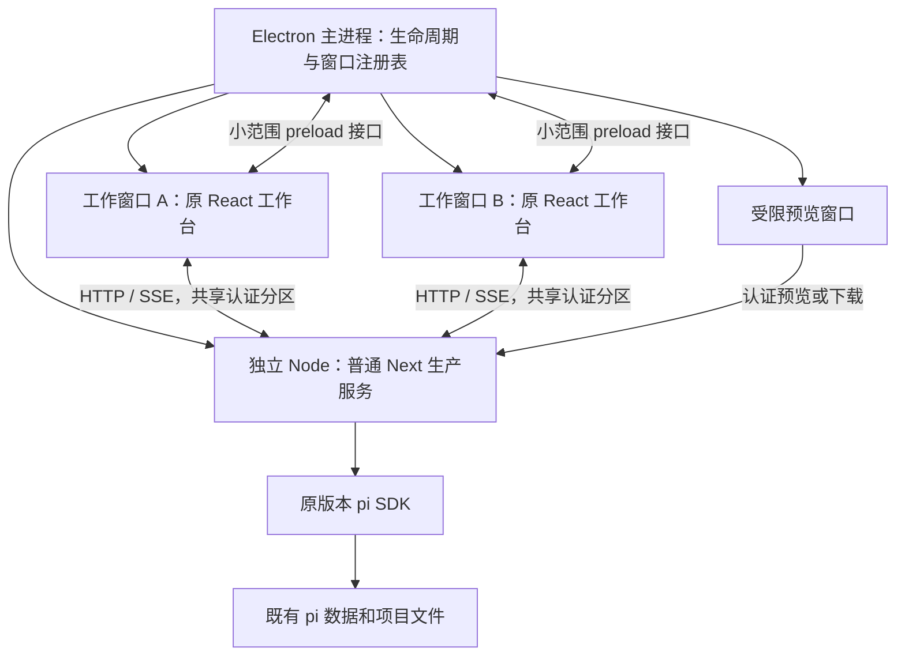

# Pi Web Desktop 实施计划书（历史归档）

> 已失效的历史方案（2026-10-20）：当前唯一技术基准为 **Pi Agent SDK + Electron + TypeScript**，直接使用 `pi-agent-core.Agent`。实施须遵循[当前技术设计与约束](/Users/liyingjun/Desktop/SW-QA/13-pi/agent-client/docs/技术设计与约束.md)。下方正文仅为历史快照，其中 Web/Next.js/独立 Node 服务、HTTP/SSE 业务链、旧 API、R0 全量迁移和阶段门均不是当前执行要求；旧任务状态不代表当前客户端进度。功能语义可供对照，不自动扩大首版范围。

版本：v2.0 · 日期：2026-10-19 · 状态：历史归档，不作为当前实施规范。目标：保留本地 Pi Web 原有工作台，增加 Electron 交付方式，不修改 pi 框架。

## 1. 唯一基线与阅读顺序

用户已确认：以本地 [pi-web-main](/Users/liyingjun/Desktop/SW-QA/pi-web-main) 为准。其包为 `@agegr/pi-web@0.12.2`，仓库标识为 `agegr/pi-web`；不以 `xing-shuyin/pi-web-ui`、AQA Demo、Vue 工作台文档或在线演示替代功能基线。

| 文档 | 职责 |
|---|---|
| 本文件 | 范围、架构、技术契约、不可突破的边界、执行规则 |
| [02-功能基线与验收清单](/Users/liyingjun/Desktop/SW-QA/13-pi/docs/pi-web-desktop/02-功能基线与验收清单.md) | B01–B37 原有功能、桌面变化和验收要求 |
| [03-任务分解与执行记录](/Users/liyingjun/Desktop/SW-QA/13-pi/docs/pi-web-desktop/03-任务分解与执行记录.md) | T00–T12 的依赖、输入、修改范围、产出与完成门槛 |
| [source-baseline.json](/Users/liyingjun/Desktop/SW-QA/13-pi/docs/pi-web-desktop/source-baseline.json) | 源码指纹、67 个 API 路由、pi 固定依赖与现有脚本；不是测试通过报告 |

以下为原 v2.0 历史正文，当时的主规范声明现已失效。旧产品方案 v1.1 保留作决策背景，其“站内新链接改为单窗口切换”“所有系统通知后移”等内容不再适用。用户后续明确要求优先；发现其他文档冲突应记录来源，不自动合并为更多功能。

当前源目录没有 `.git`，不存在可核实的 commit；已记录 761 个文件哈希。实施开始时先确认源文件是否变化，记录差异和选定版本。快照不包含全部图标及静态资源，不能代替发布资源完整性检查。

本轮只交付计划书。所有任务初始为待开始；方案中的示例文件名、命令和接口不代表已经实现。

## 2. 范围与优先级

### 2.1 两条独立的优先级规则

**R0：原有能力保留义务。** 功能清单 B01–B35 的现有工作台行为必须保留；B36 的浏览器专属能力继续在 Web 模式可用；B37 的更新入口在桌面上等价替换。不能用“这是 P1”“缺少运行环境”“Electron 不方便”来删除原有入口或改变业务语义。

**P0/P1/P2：仅用于桌面新增能力排期。** 延期新增功能不等于允许原有功能退化。真实环境暂不可测必须登记“待验证”，不能将原有功能改成假数据或静默隐藏。

| 编号 | 新增桌面能力 | 优先级 | 交付边界 |
|---|---|---|---|
| N01 | 安装包、内置 Node/npm、生产服务启动 | P0 | macOS arm64 默认目标；具体版本在 T01 固定 |
| N02 | 应用单实例、多个工作窗口 | P0 | 多窗口用于承接原有浏览器新标签语义，所有窗口共用一个后端 |
| N03 | 原生菜单、窗口尺寸、复制粘贴、退出流程 | P0 | 不新增可拖拽多窗格、窗口编排系统 |
| N04 | 本机认证、启动身份核对与受限 preload | P0 | 业务保留 HTTP/SSE，只加必要桌面控制 |
| N05 | OAuth/外链/预览/下载分流 | P0 | 所有现有相关入口可用，不统一禁用新窗口 |
| N06 | 启动故障、服务崩溃、诊断与端口冲突恢复 | P0 | 不自动重放业务命令，不建设任务恢复引擎 |
| N07 | 应用运行期间的既有完成/等待输入通知适配 | P0 | 沿用原事件与偏好；不要求退出后继续通知 |
| N08 | 可写运行文件、手动升级、签名公证 | P0 发布要求 | 内部验证包与正式发布包分别标识 |
| N09 | 跨重启文本草稿、最近位置恢复 | P1 | 原有内存草稿语义 P0 已保留 |
| N10 | 关闭最后窗口后驻留、托盘、后台通知增强 | P1 | 不改变 P0 的明确退出流程 |
| N11 | 原生目录选择、独立数据目录管理界面 | P1 | 现有目录浏览器和 PI_CODING_AGENT_DIR 支持 P0 保留 |
| N12 | 自动更新与下载后安装流程 | P1 | P0 提供正确的手动更新说明 |
| N13 | Windows/Linux、macOS Intel 等其他发布目标 | P2 | 各目标需独立验证；不能删掉原 Web 的跨平台代码 |

P0 不新增：文件编辑器、Git 暂存/提交、SSH、云同步、任务调度、模型审批平台、另一个插件协议、自动安装用户开发环境。现有目录创建、上传、worktree 删除和设置表单写入仍保留；“文件预览只读”不能被误解为删除这些现有能力。

### 2.2 不得改变的业务语义

- 不改 pi 包源码、导出、私有方法、模型协议、工具定义语义、会话 JSONL 格式；不使用 patch-package、postinstall 补丁或 monkey patch 绕过限制。
- 当前 7 个 `@earendil-works/*` 直接依赖均为 `1.2.0`；本项目不顺手升级 pi、Next、React。已有 Pi Web 对 SDK 内部模块的读取保持现状，不借机扩展到更多私有接口。
- 不把服务内嵌会话改成启动 Pi CLI、解析终端输出或第二套 Agent 调度器。
- 保留现有 API 方法、业务响应、SSE 事件、扩展 UI 字段、工具预设及信任规则。桌面身份检查不等于改变模型认证。
- 不以“原生化”为理由重写 React 页面、改 Vue、迁移 Vite、静态导出 Next 或把业务 API 全部改成 IPC。
- 不硬编码默认模型供应商、不禁用子智能体/MCP/codemode、不去掉设置面板来缩小回归范围。
- 保留现有测试；不得通过删测试、扩大 skip、放松断言或只截图 Demo 宣称完成。

## 3. 架构与模块责任



| 层 | 负责 | 不负责 |
|---|---|---|
| Electron 主进程 | 启停后端、认证引导、窗口类型、导航、下载、退出、诊断 | 不创建 AgentSession，不存模型凭据，不裁决工具权限 |
| 工作窗口 | 现有 AppShell/React/HTTP/SSE、原有交互 | 无 Node 集成，不直接访问任意本机路径或执行命令 |
| preload | 显式类型化的窗口/诊断/退出状态接口 | 不暴露通用 fs、exec、fetch-proxy 或整套 ipcRenderer |
| Node 后端 | 现有 API、会话与工具运行时、数据读写 | 不依赖 Electron API，不依赖可写安装目录 |
| pi SDK | 原有推理、上下文、工具与扩展协议 | 不增加桌面字段，不写桌面配置 |

建议新增文件，仅是实现责任的定位，不要求为凑结构创建空模块：

```text
desktop/
  main/                 启动入口、窗口、导航、认证、诊断和退出
  preload/              工作窗口受限桥接；预览窗口不加载业务桥接
  backend-hooks.cjs     普通 Node 的父进程断开与退出钩子
  build/                运行文件准备、构建配置和资源清单生成
  tests/                单元、集成、Electron 与安装包验收
  README.md             实际可运行命令与已知限制
```

允许合并小文件，禁止以本目录为理由创建桌面版聊天状态管理、第二个事件总线或新的后端服务框架。

## 4. 运行文件与打包契约

### 4.1 默认布局与验证顺序

应用资源目录提供固定 Node、npm/npx、Next、pi 及必要依赖，原生模块放在 ASAR 外。构建完成后这些资源不由应用启动过程修改。

用户目录使用 `app.getPath('userData')`，默认包含：`desktop-state.json`、`runtime/<buildId>/`、`logs/`。模型凭据与会话仍使用 pi 原有 agent 目录，不迁入桌面状态文件。

推荐布局需要 T02 实测，不能直接宣称已验证：

1. `runtime/<buildId>/` 放必要的可写 `.next`、生产配置及包元数据。
2. `node_modules`、public 和固定依赖通过经过验证的路径/链接引用安装包资源；保持同一 SDK 实体，避免重复加载导致 instanceof 失败。
3. 执行现有运行密钥轮换，缓存也写入可写位置。
4. 在无开发依赖、移动安装位置、重新安装及普通权限下验证模块解析。
5. 分离布局失败时，允许技术验证尝试完整后端运行副本；记录体积、首启、签名与更新影响。两种布局只冻结一种进入实现，不同时维护两套生产后端。

禁止用 Next 私有配置补丁、NODE_PATH 泛化修复或删除动态模块来解决路径问题。不能只复制 manifest 后跳过其余运行文件验证。

### 4.2 依赖与版本

- 项目和锁定依赖要求 Node `>=22.19.0`，T01 选择一个实际受支持的精确版本并记录校验值。Electron、electron-builder 同样固定版本，不用 latest 作为实施规范。
- Node 后端原生依赖针对实际 Node 构建；Electron 壳依赖单独处理，防止工具自动按 Electron 目标重建后端 node-pty。
- 构建阶段保留完整构建依赖，运行阶段以实测得到的资源清单收集；devDependencies 中的条目是否可省不能仅按字段猜测。
- MCP 内部文件、扩展动态加载、WASM、node-pty 辅助程序和 public 资源均须进入发布验证。不得通过关闭 MCP/codemode 使安装包“成功”。
- 内置 npm/npx 必须匹配 `lib/node-cli.ts` 查找布局，安装的插件/技能仍落在原有目标位置，不能向只读应用依赖目录安装。
- Finder 启动下的 PATH、代理和项目 Node 版本必须测试。后端使用绝对路径；不能为方便而让用户所有终端命令强制改用内置 Node。
- Git、Python、uv 或第三方 MCP 命令缺失时沿用具体错误提示，不自动下载完整开发环境。

### 4.3 原子准备与数据保护

`buildId` 由发布版本及构建产物指纹组成。先写临时运行目录，完成清单校验后再启用；准备失败保留用户数据和诊断。只有当前应用自己创建、已确认不在使用的运行目录才可清理。

手动升级保留同一应用标识、userData 与 Chromium 分区。旧运行副本存在不代表能自动回滚；P0 不提供自动回滚承诺。不得清理 `~/.pi/agent`、用户项目或未归属本应用的 npm 缓存。

## 5. 后端启动、就绪与认证

### 5.1 固定流程

`应用单实例锁 → 状态载入 → 运行目录准备 → 选端口 → 启动 Node → 验证本次服务身份 → Web 认证 → 打开首个工作窗口`。

第二次启动只激活已有工作窗口，不另起服务。用户主动“在新窗口打开”不受单实例锁限制，但复用已有服务与认证分区。

Node 运行普通 Next 生产 CLI；可用 Node preload/IPC 加最小生命周期钩子，不依赖 Next 私有启动函数。不直接套用原 CLI 自动浏览器和 5 秒强杀策略，也不重写 HTTP 服务。

优先复用上次成功端口；首次选择可用端口。实际监听是最终依据，探测存在竞态。端口占用时允许用户切到空闲端口，说明基于来源的界面偏好可能回到默认，pi 数据不受影响。所有窗口必须连接同一选定来源，运行中不偷偷换端口。

### 5.2 就绪接口的最小契约

现有接口不能证明“返回者是本次启动的服务”，且向未知监听者先发送 Web 密码不合适。允许新增 **一个** 桌面专用只读探测接口，建议 `GET /api/desktop/health`；T03 固定实现，不增加通用管理 API。

- 仅明确桌面模式启用；Web 模式返回 404。保留 Host/Origin 检查。
- 接受主进程生成的固定长度随机 challenge，返回协议版本、随机 instanceId 与 challenge 的 HMAC。HMAC 使用当前启动的随机 `PI_WEB_PASSWORD`，应绑定协议版本和 instanceId；原密码不返回、不进入 URL。
- 主进程校验 instanceId 与 HMAC 后才发送登录密码。缺少接口、旧实例、伪造 200、错误签名均失败，不加载页面。
- 此路由可仅对 GET 免除登录检查，以完成登录前身份核对；必须限定精确路径和桌面模式，不能扩大 `/api` 豁免。它不列出数据、模型、路径或任务，不创建 AgentSession。
- “健康”只证明该 HTTP 服务可用，不证明模型账号、MCP 或所有任务成功。
- 临时凭据每次后端启动重新生成。继续复用现有 Web 认证作为业务访问权限；该探测不是第二套用户认证系统。

若 T03 能用已验证的受控进程通道完成同等身份核对，可记录 ADR 后取消该路由；不得两种方案并存或跳过身份核对。此选择限于就绪实现，不允许改成另一套业务协议。

### 5.3 认证与重启

通过现有 `POST /api/web-auth` 登录；主进程必须明确使用工作窗口的持久化 partition，或将合法响应 Cookie 写入该 partition。不得假设 Node fetch 与 Chromium 自动共享 Cookie。HttpOnly Cookie 不通过 preload 暴露。

所有工作窗口与预览共用认证分区；外部浏览器不共用认证。权限处理器同时检查来源和窗口类型，仅允许业务确需权限。退出/重启清理旧认证 Cookie，不清空用户主题等无关存储。

端口不是 Cookie 的隔离边界，不能假设同一主机换端口就不会携带 Cookie。该分区只承载本应用已核实的来源及受限预览，禁止导航到其他回环服务；跨来源重定向重新进入导航校验。不要向任意请求统一追加认证头。

已有终端、bash 和 MCP 环境过滤优先复用；新启动链及 npm/npx 继承路径补测。新增的 instanceId 非授权凭据，不可拿它代替 Web 登录。

后端退出时保留可见错误，暂停发送；用户选择重启后先完成认证再重连。不能自动重新提交 prompt、上传、工具命令或旧审批。浏览器现有 SSE 自动重连允许恢复视图，不等于允许重放操作。

## 6. 多工作窗口、预览和 preload

### 6.1 窗口模型

窗口注册表仅保存窗口 id、类型、所属后端 instanceId、当前用途及退出所需的瞬时状态；不复制会话内容与运行状态数据库。

| 操作 | 规定行为 |
|---|---|
| 普通点击会话 / Enter | 沿用当前页面切换，不整页重载 |
| Cmd/Ctrl 点击、中键、菜单“在新标签页打开” | 桌面上新建工作窗口；仅标签文案可改为“在新窗口打开” |
| 项目/工作树在新窗口打开 | 以明确 cwd 打开新输入区，不自动创建/复制/发送会话 |
| A 窗口打开 B | A 的会话、草稿、文件页签和项目状态保持；B 只按显式 URL 初始化 |
| 两窗口同时看同一会话 | 共享后端既有单会话封装，不另建 AgentSession；保留原有并发控制，不新增跨进程锁协议 |
| 主题/字体等偏好修改 | 继续利用同一来源的 localStorage/storage 事件同步 |
| 关闭非最后工作窗口 | 只销毁该窗口，不停止其他窗口任务；未发送输入有提示；终端沿用原来断开/回收规则 |
| 关闭最后工作窗口 | 走全应用退出流程；预览窗口不算工作窗口，不使服务意外常驻 |
| Cmd+Q | 退出全部窗口与该应用后端 |

新窗口不应克隆源窗口 sessionStorage；原先通过 URL 指定的 session/cwd 优先级保持。不新建窗口管理首页、分屏调度器或同步所有编辑状态。

### 6.2 导航分流

同源并不意味着可以任意注入 preload：工作台根页面与已识别的会话/项目 URL 才可创建工作窗口。导出、PDF 和预览页面不得加载业务桥接。

外部 HTTP(S)/OAuth 使用系统浏览器；本地受保护的导出/文件预览使用同一认证分区的受限预览窗口或下载。Blob、原文件名、PDF 页码片段、现有 iframe 隔离规则要保留。未知协议拒绝或明确提示，不能调用任意系统程序。

`nodeIntegration=false`、`contextIsolation=true`；不关闭 webSecurity，不给预览页面 Node 能力。P0 无需注册自定义 URL 协议。

### 6.3 最小 preload 契约

实现前由 T04 冻结类型；以下是能力上限，不要求用不到的接口也实现：

| 接口能力 | 输入/输出边界 |
|---|---|
| 只读桌面标记与版本 | 平台、桌面版本、是否支持诊断；不包含凭据或服务器任意配置 |
| 请求退出/响应退出探测 | requestId、窗口是否有未发送输入或终端；不发送正文与命令内容 |
| 打开诊断入口/导出诊断 | 由主进程确定诊断目录和内容；不能传任意本机路径 |
| 桌面通知适配（确有需要时） | 受限标题、正文、sessionId、事件标识；不能指定任意打开路径 |

窗口创建优先由 Electron 的窗口/导航事件处理；不为已有 API 添加一组 IPC 镜像。每个 IPC 校验 sender 的注册窗口、当前 URL 和数据结构；预览及外部页面不能调用。

异步请求带 requestId，重复退出请求合并；窗口销毁后清理监听，失效窗口的迟到回复不生效。IPC 校验失败返回受限错误，不回传堆栈中的凭据。这些规则只用于桌面接口，不引入新的业务消息封装。

## 7. 生命周期与原有通知

### 7.1 状态机

`STARTING → READY → EXIT_CONFIRM → STOPPING → STOPPED`；启动失败进入 `START_FAILED`，后端异常进入 `SERVICE_FAILED`。

- EXIT_CONFIRM 取消返回 READY；确认之前不能关闭后端或清空草稿。
- STOPPING 后禁止新工作窗口和新提交；所有退出来源合并成一次过程。
- 已管理活动任务信息使用 `/api/agent/running`；窗口提供瞬时草稿/终端状态。状态超时未知时保守提示，不猜数量。
- 给后端正常关闭机会，先处理前端长连接与资源清理，再等待进程退出；不得复制 CLI 与会话封装相同的默认 5 秒预算。
- T05 明确各期限与测试依据。超时进程仍在时允许继续等待或强制退出；不能承诺已终止外部 daemon。
- 主进程异常消失时，Node 钩子通过 IPC 断开触发受限自清理。不得遍历系统杀掉所有 node、shell 或其他 pi CLI。

### 7.2 通知是保留项

现有完成提示音、非活动窗口的完成通知、等待用户输入提醒与点击回到对应会话属于 B33，P0 必须验证。优先复用 renderer Notification；只有 Chromium/Electron 实测无法达到现有行为时才加最小主进程通知桥接。

桌面禁用 PWA 注册时，也必须让 `setupPushSubscription` 在桌面模式直接结束，不能继续等待永远不会存在的 `serviceWorker.ready`。Web 模式保留 PWA/Web Push。

原来只在可见页面轮询的路径若不能支撑最小化后的既有提醒，允许桌面专用的受限状态观察适配；只读取既有状态/事件，不执行任务、不新建会话。多窗口只对同一事件提示一次，点击定位/打开对应工作窗口。中止任务不伪装为完成通知，权限拒绝有可理解的状态，不反复弹窗。

应用退出后的通知、无工作窗口驻留和新的通知中心仍是 P1，不是 B33 的默认要求。

## 8. 数据与产品行为边界

默认遵循 pi 的 agent 目录规则；首次说明实际目录与 CLI 共用关系。环境指定目录仍支持，Finder 不继承 shell 变量的差异明确说明，不执行所有 shell 配置来猜测。

原会话 JSONL、插件/技能目录、项目 MCP、全局配置和 OAuth 存储保持 SDK 行为。桌面端不额外迁移格式、不复制密钥到自己的状态文件。SDK 原有读取/迁移行为不能被误写成保证源文件字节永远不变。

只恢复落盘历史，不给每个轮次虚构“中断/完成”状态。应用级上次非正常退出提示与真实会话事件分开。内存草稿、附件、文件页签和终端生命周期按原行为保留，跨重启新增恢复属于 P1。

P0 手动升级不执行 `pi-web update` 或 npm 全局更新；关于页显示桌面版、内嵌 Pi Web 和 pi 版本。未配置分发地址时不得出现假下载按钮。签名资料缺失可交付标明限制的内部包，但不能标记正式发布完成。

## 9. 修改范围与变更控制

| 范围 | 规则 |
|---|---|
| 新增 desktop/ 与其构建、测试、文档 | 允许按当前任务直接实现 |
| package.json / 锁文件 / TS / lint 配置 | 只加入桌面所需内容；锁文件变化说明原因，原依赖解析不得无关漂移 |
| AppShell、SessionSidebar、PWA、通知、下载与更新入口 | 只做显式桌面分支；保留 Web 默认行为和所有原有操作 |
| proxy.ts、新 health 路由、Node 生命周期挂钩 | 仅为受限桌面探测与启动；修改前列出安全和回归用例 |
| 会话、MCP、工具、数据核心 lib | 默认仅阅读；若确有桌面阻断，先给复现、最小修复与回归范围，不能趁机重构 |
| pi 包、node_modules 补丁、全局系统环境、用户真实数据 | 禁止作为绕过兼容问题的修改目标 |
| demo/、旧 AQA 原型、无关样式与业务功能 | 不进入实施范围 |

Agent 可自主决定局部命名、文件合并和使用现有 API 的小实现细节，无需反复询问。下列变化必须形成变更请求并由用户决定：删减 B 功能、改变工具/会话语义、增加框架、升级核心依赖、改变数据格式、换架构、扩大发布平台、引入常驻服务或访问真实凭据做测试。

变更请求模板：问题与复现 → 影响的 B/N/T 编号 → 最小候选方案 → 代价/数据影响 → 所需批准。等待时可以继续不依赖该决定的检查，不能把沉默当作批准。

## 10. 质量、测试和证据

使用 [原项目测试说明](/Users/liyingjun/Desktop/SW-QA/pi-web-main/e2e/README.md)。实际现有命令为 `npm test`、`node_modules/.bin/tsc --noEmit`、`npm run lint`、`npm run test:e2e`、`npm run test:terminal`。原 E2E 自建临时 agent 数据，无模型凭据；它不覆盖真实模型流式执行，不能因此宣称模型集成通过。

生产构建只能在隔离发布目录执行；`npm run build` 是现有生产构建命令，不在有开发服务的同一 checkout 运行。`E2E_SERVER_MODE=start` 可用于已有生产产物的浏览器回归。Electron 测试需新增并实际运行；不能把计划中的 `desktop:*` 命令当作已有命令报告。

每个证据记录：执行目录、代码/产物指纹、系统/架构、Node/Electron 版本、用例、期望、实际结果、命令退出码或操作记录、截图/日志位置、真实或模拟、时间。模拟可以验证界面分支，不能替代真实网络、原生模块、签名或系统通知验证。

测试数据一律使用临时 `PI_CODING_AGENT_DIR` 与测试项目。涉及修改、删除、worktree、插件安装和 MCP 外部命令时使用明确受控样本；不拿用户真实会话做回归。

完成判定：每条 R0 功能有通过证据或有明确的平台不适用理由；平台不适用只用于能力在该平台原本就不存在的情形。缺凭据/设备是阻塞，不是“不适用”。已有基线失败要独立记录，不算桌面改造造成，也不能悄悄删除；若影响发布核心能力，仍须解决或经用户明确接受限制。

## 11. 阶段门与 Agent 执行纪律

| 阶段门 | 必须完成 | 不能越过的条件 |
|---|---|---|
| G0 基线确定 | T00、T01 | 源码漂移不明、版本未固定、修改未归属 |
| G1 最难技术链路 | T02、T03、T04、T05 的验证版本 | 运行文件、认证、多窗口或退出仍靠临时绕过 |
| G2 工作台等价 | T06–T10 | B 功能被删减、原 Web 被破坏、模型/扩展测试证据缺失 |
| G3 发布候选 | T11、T12 | 签名/安装/升级/回归不通过，或未测项被当成通过 |

阶段门达到标准可自主推进已授权的下一任务，不需要每一步再询问。失败时修复本任务或登记阻塞，不能靠改文档的验收标准来“通过”。技术探索阶段允许记录被否决布局，产品代码只保留选定布局。

每个任务开工前声明 T 编号、关联 B/N、修改文件和验收方式；完工后提交变更与证据。一个阶段只做该阶段所需内容，不提前实现 P1/P2。不要在任务完成后继续整理无关代码。

若未来使用多个 Agent，必须由用户明确授权；所有 Agent 共用本计划，每项任务只有一个写入负责人，不能各自另起桌面框架或依赖版本。本计划本身不要求多 Agent。

## 12. 可直接交给实施 Agent 的起始指令

> 请按本目录 v2.0 计划实施 Pi Web Desktop，功能基线仅为用户确认的本地 pi-web-main。先阅读 01、02、03 和 source-baseline.json，再读取原项目及涉及子目录的 AGENTS.md 与对应专题说明。当前只从 T00 开始，依照依赖和阶段门推进已授权的 P0 任务。保留所有 B01–B37 对应能力及其规定的平台行为，不修改 pi 框架，不改业务协议，不使用 AQA/Vue 或 demo 替代真实工作台。每项任务先说明编号、修改范围和验证方法，完成后更新执行记录并附真实证据。缺少运行凭据、设备、签名或外部条件时登记阻塞，继续独立工作，不伪造通过、不删除测试、不擅自降级功能。局部实现自主决定；架构、功能和数据边界变化必须按变更请求处理。不要在开发 checkout 运行生产构建，不操作用户真实会话，不自动发布。最终交付说明已完成、待验证、阻塞及下一可执行任务。
