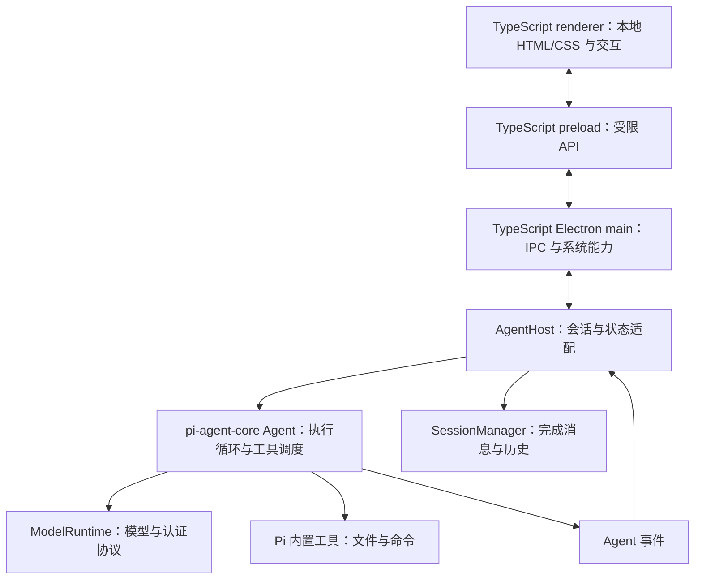

# Pi Agent 客户端技术设计与约束

版本：v1.2 · 更新日期：2026-10-20 · 状态：当前技术设计基准。

## 1. 唯一技术基准与文档优先关系

**本项目使用 Pi Agent SDK + Electron + TypeScript 实现 Agent 桌面客户端。** 用户已明确要求直接使用 `@earendil-works/pi-agent-core` 的 `Agent` 构建执行核心。

唯一工程为 `/Users/liyingjun/Desktop/SW-QA/13-pi/agent-client`。旧 `client/`、`desktop/` 和项目内 `.pi-web/` 已移除。

本文定义技术边界；[协作指南](/Users/liyingjun/Desktop/SW-QA/13-pi/agent-client/AGENTS.md) 定义执行规则；[操作与功能修改指南](/Users/liyingjun/Desktop/SW-QA/13-pi/agent-client/docs/操作与功能修改指南.md) 提供源码定位、使用和验证方式；[首版实现说明](/Users/liyingjun/Desktop/SW-QA/13-pi/agent-client/docs/pi-web-desktop/04-SDK客户端首版实现说明.md) 记录交付范围。

用户最新明确要求优先。历史 Pi Web 方案只供产品语义追溯，其中 Next.js、独立 Node 服务、HTTP/SSE 业务链、旧 API 或阶段门不约束当前工程，不据此恢复 Web 加壳方案。新增能力仍按用户确认范围实施，本文不构成扩大功能范围的授权。

## 2. 技术约束清单

| 编号 | 必须满足的要求 | 核对位置与方式 |
|---|---|---|
| T01 | 使用 Pi Agent SDK；主进程直接 `new Agent(...)`，执行循环和工具调度由 Agent 负责 | `src/main/agent/agent-host.ts`；实例及实际执行集成测试 |
| T02 | 不用 `createAgentSession` / `AgentSession` 代管执行，不解析 CLI 输出，不自建 Agent 循环 | 当前业务源码与运行调用链 |
| T03 | Electron 承载桌面窗口、系统文件选择、菜单、退出和 IPC | `src/main/index.ts`、原生窗口测试 |
| T04 | main、preload、renderer 业务逻辑均为 TypeScript；HTML/CSS 用于结构和样式，构建/测试脚本可用 `.mjs` | `src/`、`tsconfig.json`、类型检查 |
| T05 | renderer 使用本地 `file://` 页面与受限 preload/IPC；不运行 Pi Web、Next.js 或本地 HTTP/SSE 业务服务 | `createWindow/loadFile`、`src/preload/index.cts`、依赖和启动脚本 |
| T06 | SDK、模型请求、认证和文件工具位于主进程；renderer 不访问 Node、SDK 或凭据文件 | IPC 与运行时隔离测试 |
| T07 | 复用 Pi 模型、工具、消息及 JSONL 辅助模块，不修改框架源码或另造协议 | `ModelRuntime`、`createCodingTools`、`convertToLlm`、`SessionManager` 调用 |
| T08 | 保留 Electron 隔离、CSP、IPC 来源与参数校验；不暴露任意 IPC/Node 通道 | 主进程、preload、HTML CSP 和界面测试 |
| T09 | 模型配置、模型选择与请求参数一致；当前身份信息跟随每次选择和历史恢复 | `setModel`、`streamFn/client_model`、请求参数回归测试 |
| T10 | 使用真实工具、流式事件、取消和历史续接；不以固定回复或界面状态模拟成功 | SDK 集成测试与 Electron 主流程 |

当前 renderer 是原生 DOM 与 TypeScript 实现，不使用 React。当前构建使用 TypeScript 编译与 esbuild，构建前清理旧 dist，复制功能样式目录；这些是已实现的工程选择，与上表必须遵守的三项技术基准分别说明。

## 3. 运行架构与职责

| 层 | 文件 | 主要职责 |
|---|---|---|
| 系统与窗口 | `src/main/index.ts`、`src/main/ipc/register.ts` | 窗口与生命周期；白名单 IPC、选择器、信任和校验 |
| Agent 适配 | `src/main/agent/agent-host.ts` | 直接创建 Agent、模型选择、资源上下文、发送、流式状态、工具结果、停止与续接 |
| 模型配置写入 | `src/main/models/model-config.ts` | 校验输入、文件锁、模型与凭据分开存储 |
| 通信桥 | `src/preload/index.cts` | 暴露 `window.agentClient` 的明确方法和订阅 |
| 界面 | `src/renderer/` | 页面、样式、渲染、交互、草稿和错误展示 |
| 通信契约 | `src/shared/types.ts` | `AgentClientApi`、`SessionView`、`ModelChoice`、`IpcResult` |

`pi-coding-agent` 在本工程中仅提供模型运行时、工具、资源加载、消息转换和历史等辅助模块；其存在不意味着使用 `AgentSession` 作为执行核心。项目中固定的 MCP、TUI 等依赖也不意味着相应产品功能已经接入。

模型网络调用由 SDK 在主进程中发起；禁止的是新增本地业务服务，不是禁止访问用户配置的远程模型接口。

## 4. Agent 主流程与状态契约

1. 原生选择项目并登记授权路径，按 Pi 规则处理项目信任。
2. `SessionManager` 创建或读取会话，`ModelRuntime` 加载可用模型，资源加载器提供声明式上下文。
3. `AgentHost.load` 直接创建 `Agent` 并订阅事件；`Agent.prompt` 接收任务和图片，普通文件以路径加入上下文。
4. `message_*` 和 `tool_execution_*` 事件转换为 `SessionView` 推送界面；完成消息交由 Pi JSONL 管理器保存。
5. `Agent.abort()` 发送取消信号，`waitForIdle()` 等待请求、工具与回调收尾，再释放订阅。
6. 恢复历史只读取上下文；用户再次发送时才执行新任务，不自动重放工具或旧请求。

运行任务时拒绝重复发送及模型/思考级别切换。跨会话草稿在 renderer 内存中隔离，不承诺退出恢复。退出有草稿或运行任务时询问，取消应保留窗口和任务。

Pi Agent 是客户端名称，不能作为底层模型或开发者身份。请求中附带当前配置的 provider/model ID，切换及历史恢复后继续更新；配置标识和模型自述不能独立证明服务端实际模型来源。

### 4.1 会话管理（2026-10-20）

- 重命名使用 `SessionManager.appendSessionInfo`，名称为 1–120 字符的非空单行文本；已加载会话复用原管理器，未打开历史仅打开管理器，不启动 Agent。空会话遵循 SDK 延迟落盘规则，首次发送后持久化。
- 分支续聊采用侧栏 Fork 语义：复制当前叶节点至独立会话，原会话不变。使用独立 `SessionManager.open` 调用 `createBranchedSession`（该接口会切换调用者的目标文件），再为副本设置名称。只复制已保存消息，允许源任务继续运行；不发起模型请求、不重放工具。空会话拒绝分支。
- 删除前界面明确二次确认，默认聚焦返回。主进程先 `abort/waitForIdle`，并等待 `send` 的最终持久化和列表通知完成，然后移除该 JSONL、订阅和内存实例；UI 清理该会话草稿。项目文件、其他会话和分支保留，不递归删除关联会话。
- 管理 IPC 只接收 ID，不接收文件路径。主进程从既有 Pi 目录和已加载实例定位管理器；同一会话的管理操作互斥，并等待已有打开操作收尾。删除期间不接受新的发送和模型变更。
- 本轮不包含消息级编辑/分支导航、归档、置顶、批量管理或子 Agent 会话级联删除。

## 5. 数据、认证与安全边界

- 默认数据目录为 `~/.pi/agent`，支持 `PI_CODING_AGENT_DIR`。复用既有 `models.json`、`auth.json`、设置与 `sessions/` JSONL；不因工程清理删除用户数据。
- API Key 仅在主进程使用；表单写入 `auth.json` 时使用文件锁与 `0600` 权限，不返回 renderer，不写入模型定义、会话或日志。表单只支持 OpenAI 兼容模型配置，保留其他协议条目；无效 JSON/JSONC 报错并保留原文件。
- preload 仅暴露声明的方法。IPC 校验当前窗口、main frame、页面来源与参数；项目和普通文件附件需经过原生选择器授权。
- 保留 `nodeIntegration: false`、`contextIsolation: true`、`sandbox: true` 和 webSecurity；renderer CSP 禁止直接网络、内联脚本、frame 和 object，Markdown 使用 DOMPurify 清理。
- 原生外链只允许 HTTP(S)，阻止内部页面导航到外部内容以及 webview 挂载。
- **Electron renderer 沙箱不限制主进程工具的文件范围。** 本轮单独接入 `main/workspace/permissions.ts` 和 `sandbox.ts`：默认工作区读写、只读、完全访问三档。受限文件工具使用真实路径/链接校验及 macOS 沙箱进程完成内容 I/O，命令通过 SDK `spawnHook` 进入同一文件沙箱；完全访问使用原生 Pi 工具。
- 系统运行目录和设备按需可读，网络不由文件权限入口限制，客户端自身的历史保存/模型请求/用户主动选择图片不属于工具只读约束。文件工具拒绝修改多硬链接文件；跨边界硬链接与外部进程并发修改等对抗性场景不作完整隔离保证。
- 受限命令不继承主进程密钥和启动注入变量，使用固定 shell、最小环境、无 profile/rc 启动；SDK 继续负责流式输出、超时与取消，命令子进程继承系统沙箱。
- 权限以 SDK `appendCustomEntry('pi-agent-client:workspace-permission', {mode})` 保存，重启和同项目分支恢复；旧历史默认工作区读写，新会话不会继承另一会话完全访问。任务中拒绝变更；异步配置收尾时再次检查忙碌/删除状态。
- 当前系统适配为 macOS；其他系统受限文件/命令操作明确拒绝，不退回无限制。项目信任仍只约束 Pi 项目资源。

## 6. 界面依据与交付范围

界面参考 `docs/demo/` 和用户最新调整：暖白主题、左侧会话、居中聊天、默认收起右侧信息栏，输入底栏按附件、模板、模型、思考和权限排列，发送/停止在右侧；不恢复已移除的“只读工具”选择器。

当前主流程范围为项目选择、会话新建/续接/改名/删除/分支、模型配置与切换、流式消息、实际工具、停止、附件、提示模板、会话搜索与信息展示。原型只约束设计，不把其模拟数据、固定回复、HTTP/SSE 示例直接迁入业务。

尚未完整接入：其他系统的文件/命令沙箱、插件/技能/MCP 管理、扩展自定义 UI、Git/文件预览面板、PTY、系统通知、多窗口、签名公证和其他平台验证。当前资源加载器 `noExtensions: true`，不启动第三方扩展生命周期；声明式模板和受信任的项目上下文继续加载。

外部模型账号、OAuth 和第三方服务按实际联调结果登记；保留历史产品功能作为后续对照，不将历史完整工作台的交付范围自动当作本次首版已完成。

## 7. 依赖、开发与验收

依赖精确版本及锁文件以 `package.json` / `package-lock.json` 为准。当前 Pi 的 7 个包均为 `1.2.0`，Electron `44.9.0`，TypeScript `5.9.3`。不为满足设计文档擅自升级框架或改动依赖源码。

所有命令在 `agent-client/` 执行：

| 命令 | 目的 |
|---|---|
| `npm run dev` / `npm start` | 构建并打开 Electron；当前无热更新，修改后需退出重启 |
| `npm run check` | TypeScript 类型检查 |
| `npm run build` | 编译 TypeScript、打包 renderer、复制 HTML/CSS |
| `npm test` | SDK 集成：工具实际落盘、流式、停止、历史、配置、模板和请求身份 |
| `npm run test:electron` | 原生窗口、隔离、IPC、UI 主流程、模型切换、重启和布局 |
| `npm run package` | 生成 macOS 内部验证应用，不发布；源码变化后须重新打包 |

测试采用临时配置、项目、Electron 数据目录及受控协议服务。真实 SDK 和工具通过，不等于外部供应商账号或模型质量已验证。`evidence/` 的记录应对应本次实际执行；开发入口通过不自动代表打包应用通过。

业务修改在 `src/`；`dist/` 和 `release/` 是生成产物，`node_modules/` 是依赖。文档变更核对约束、命令、引用和链接即可，无需调用模型验证。

## 8. 模块、思考强度与输入约束

模块目录及依赖规则见 [项目目录与模块开发规范](./项目目录与模块开发规范.md)。主进程分 Agent、会话目录、模型配置、工作区工具权限和 IPC；界面分聊天、输入、会话管理、模型/思考和工作区控件。入口只协调生命周期与应用状态，样式和测试均按功能归属组织。

模型配置表单可声明 `reasoning` 并保留其他模型字段。思考选项始终由 Pi `getSupportedThinkingLevels` 提供，赋给真实 Agent；SDK 负责具体供应商请求映射。运行中拒绝切换；模型不支持时禁用选择并说明原因，恢复历史时按当前能力校验。

键盘发送与按钮使用同一 `submit` 流程。Enter 发送，Shift+Enter 换行；IME 确认、keyCode229、按键重复不发送。取消固定 200ms 抑制，确保中文输入结束后下一次正常 Enter 可以立即发送；运行中 Enter 仅保留草稿，不充当停止按钮。

## 9. 后续变更规则

涉及执行核心、进程职责、通信方式或数据格式的修改，先对照 T01–T10，遵循用户确认的技术基准；遇到冲突先指出具体差异，不自行切回 Web 加壳或另造运行时。

功能、命令、文件或接口变化时同步维护本文受影响章节、操作指南和相关 README，明确已实现、未接入及待验证状态。协作规则统一维护在客户端 `AGENTS.md`，避免重复和冲突。
