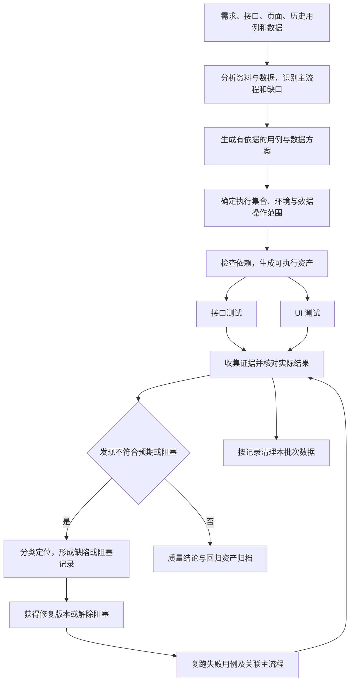

# Pi Agent 测试业务闭环设计（基础版）

更新：2026-10-21。状态：业务流程与工具选型设计，尚未接入具体被测系统或执行测试。最新实施顺序为 UI 优先，详见 [UI 测试业务流程详细设计](./UI测试业务流程详细设计.md)。

UI 首期进一步加入[自动录制、资产持久化与按需能力组合](./UI自动录制与资产复用设计.md)：新脚本经设计评估后登记，后续回放和执行复用有效资产，无需重复整条生成流程。

## 1. 目标与首版范围

测试工程师提供需求、接口资料、页面入口和环境信息，Agent 完成资料分析、用例设计、测试数据准备、接口/UI 执行、结果分析、缺陷草稿和修复回归，形成可追溯、可重复执行的测试资产。

用户明确先做通用流程，不绑定具体业务。本文中的“创建、查询、更新、结束/清理”只是业务链模板：有对应业务才采用，不推断目标系统一定有这些能力。测试对象是业务系统，不是 Pi Agent 客户端。

整体规划三条业务流，首期先交付 UI 测试闭环，接口专项和跨端联动后续接入：

| 流程 | 入口 | 结束条件 |
|---|---|---|
| 接口测试闭环 | OpenAPI、已有 Postman Collection 或明确的接口需求 | 获得可复跑的 Collection、逐用例证据、总结及待回归项 |
| UI 测试闭环 | 页面入口、需求/验收标准、测试账号 | 获得可复跑的 Playwright 测试、页面证据、总结及待回归项 |
| 接口与 UI 联动闭环 | 同一条业务链的接口、页面及字段/状态映射 | 验证接口与页面对同一数据的展示和状态转换一致 |

第一批只覆盖选定业务链的最小成功路径、关键状态/数据断言，以及有明确依据的少量阻断场景。首版先使用一个环境、一个浏览器项目和少量数据；性能、全面安全扫描、多浏览器矩阵、定时调度、自动提交缺陷和复杂测试管理平台留待后续。

## 2. 测试工程师实际怎样使用

1. 选择业务项目工作区，提供资料及本轮范围。Agent 先输出资料摘要、缺口、主流程和工具可用性。
2. 在对话中补齐会影响预期结果的规则。Agent 继续完成不受缺口影响的用例，不编造缺失规则。
3. 查看可执行的用例清单及数据影响；确定执行集合、测试环境、账号角色、允许的数据操作和清理范围。已有明确授权直接复用，不逐条重复询问。
4. Agent 生成并运行测试资产，反馈完成、失败、阻塞和证据位置。登录/验证码等必须由人参与的步骤只在实际遇到时交给人处理。
5. 查看测试总结和缺陷草稿。修复版本提供后，在同一任务中要求“回归这些缺陷及受影响主流程”，Agent 生成新批次，对比前后结果。

不要求先建设新的页面。当前对话、工作区文件、Skills 和 MCP 入口足以承载第一版；本文的状态是业务记录约定，不代表客户端已有测试任务状态面板。

## 3. 共用主流程



图中的接口与 UI 分支仅在数据和环境互不干扰时并行；联动验证按业务依赖串行。清理在每个批次结束、失败或取消后尝试执行，不能等所有缺陷修复后才清理；清理结果也进入报告。

| 阶段 | Agent 的核心操作 | 产物 | 进入下一阶段的条件 |
|---|---|---|---|
| 任务建档 | 确认系统、环境、版本、测试目标、材料范围 | 任务说明、资料版本清单 | 能确定被测对象与范围；设计可先于环境准备 |
| 分析 | 提取业务步骤、角色、字段、约束、状态与依赖；分析历史缺陷和样本数据 | 测试点、优先级、资料缺口 | 关键预期有依据；未知项保留待确认 |
| 设计 | 生成接口/UI 用例和需求覆盖映射，复用已有资产并去重 | 用例清单及修订号 | 执行集合可判定、依赖明确 |
| 准备 | 检查地址、认证、工具、测试数据；生成 Collection/测试脚本 | 可执行资产、数据集、执行计划快照 | 依赖就绪，环境与数据操作已获授权 |
| 执行 | 调用成熟执行器，保存退出码、逐用例结果和证据 | 原生报告、证据、运行日志 | 成功或失败均有明确记录；中断不伪装完成 |
| 分析结果 | 对比预期与实际，聚类失败，区分业务、脚本、环境与数据问题 | 测试总结、缺陷/阻塞草稿 | 每个结论可追溯到用例和证据 |
| 回归 | 在修复版本复现原检查，补跑受影响链路 | 新批次及前后对比 | 明确已解决、仍失败或待验证 |
| 归档 | 清理本批次数据，保存资产和未解决事项 | 回归基线、残留数据清单 | 证据可查、资产可复跑、遗留项有去向 |

“闭环完成”不等于“全部通过”。有失败时可以交付完整结果，但缺陷保持待修复/待回归；没有修复版本就不能标记关闭。

## 4. 能力选型：优先复用什么

Skills 提供方法与操作约定；MCP 连接真实工具；Pi Package 分发技能和扩展；测试执行器负责断言、超时和报告。不要只凭 Agent 的自然语言回答判断通过。

| 环节 | 首选成熟能力 | 本设计如何使用 | 适用边界 |
|---|---|---|---|
| 接口资料与用例分析 | 现有 `openapi-test-case-design` Skill | 从 OpenAPI 3 提取接口与约束，生成可追溯候选 | 当前位于 Codex 技能目录；供 Pi 使用需经现有“本地 Skill”入口导入，并在新会话核实加载 |
| 接口资产与执行指导 | 官方 `@postman/postman-plugin` Pi Package 中的 `api-testing`、`variables`、`collection-schema-v3` | 复用 Collection、变量和断言方法 | 本机发现 0.3.0 包文件；不据此推断当前 Pi 会话已加载或账号已登录 |
| 接口批量执行 | Postman CLI；已有 v2.1 JSON 项目可沿用 Newman | 运行 Collection、数据驱动、获取机器可读报告 | 一项任务选择一个主执行器；v3 目录/YAML 资产走支持它的 Postman CLI，不直接交给 Newman |
| Postman 在线资产 | 插件注册的 Postman MCP | 读取已有集合、环境及接口；存在并可用时调用 `runCollection` | 必须检查实际工具、授权和目标网络可达性；内网接口优先使用可访问内网的本地执行器 |
| UI 页面探查 | Microsoft `@playwright/mcp` | 获取页面快照、操作控件、查看网络与控制台、保存截图 | 首版采用它接入现有 MCP；发现可用工具后调用，不硬编码未发现的工具名 |
| UI 可重复执行 | `@playwright/test` | 保存测试脚本，通过 fixture、locator、expect、reporter 执行 | MCP 交互记录不自动等于可复跑用例；需沉淀并实际运行脚本 |
| 数据分析 | 首版用本地 CSV/JSON 和既有 Python/表格工具；需要时复用 Postman `datasets` Skill | 缺失值、重复、分布、边界与代表样本分析，输出参数数据 | 不把数据观察当业务规则；Datasets 的数据库源存在版本、账号和套餐前提，不作为首版依赖 |
| 多 Agent | 社区 `pi-subagents` Pi Package | 按职责分派分析、接口、UI 和结果复核 | 本机发现 0.79.1 文件，桌面实际兼容性待接入验证；不另造 Agent 运行循环 |
| 报告 | 执行器原生 JSON/JUnit/HTML + Markdown 汇总 | 原始执行结果作依据，Agent 解释差异和风险 | 首版不引入 Allure 服务或自建报告平台；以后可按已有团队体系接入 |

Playwright 官方 MCP 文档也推荐 coding agent 考虑官方 `playwright-cli` 的 CLI + Skills 路线，以减少上下文开销。首版先采用当前客户端容易接入的 MCP；若后续持续执行成本明显，再比较替换探查入口，不同时维护两套浏览器控制方式。批量回归始终优先复用测试执行器。

Postman 插件说明：关联在线 workspace 时，CLI 部分操作可能上报活动/结果。首版默认本地资产和报告，支持的命令使用 `--report-events=false`；不自动 push、发布或提交缺陷。MCP 本身连接远端，不能用该 CLI 参数声称 MCP 调用不外发。

无需新增 MCP 桥：客户端已有 Pi 原生 MCP/codemode/tool-search。工具已安装、服务已连接、工具已发现和一次业务调用成功是不同状态，接入时分别记录。

## 5. 业务流 A：接口测试闭环

### A1. 收集和分析输入

必需：接口资料或已有 Collection、测试范围、目标环境。执行时还需要认证方式、账号角色、数据操作范围及可判定的业务预期。

Agent 优先复用现有 Collection 和测试；没有现成资产才根据 OpenAPI/已确认需求生成。分析接口数量、method/path/operationId、鉴权、参数、请求体、响应、业务依赖及状态转换。资料有冲突时列出差异，不从某次响应反推规范。

### A2. 设计最小主链及数据

按目标系统实际能力映射通用链：建立身份/上下文 → 发起核心业务动作 → 获取结果标识 → 查询结果 → 验证业务状态/关键字段 → 必要的后续动作 → 结束或清理。

例如创建得到的 ID 必须传入查询或后续动作；不能让每个接口都使用无关联的固定数据后宣称业务链通过。状态码成功只是一个断言，还需校验契约、关键字段和业务副作用。

首批覆盖：

- 一条真实成功链及其关键字段/状态。
- 契约明确的必填、类型、枚举或边界检查，按业务风险挑选。
- 需求明确的权限或状态限制；未定义的错误码、重复提交、幂等行为列为缺口。

样本分析输出总行数、空值/重复/非法值数量、分布和选样理由；测试数据分为原始脱敏样本、从规则构造的数据及运行时创建的数据。合法/非法由规范决定，出现频率仅辅助排序。

### A3. 生成与执行

用 Postman 技能生成或更新选定 Collection，保存 `pm.test` 断言、变量提取和前置依赖。绑定用例 ID 与数据行 ID；认证通过凭据引用或运行环境注入，不写入用例正文。

执行前固定 Collection/用例/数据版本和执行器版本，先运行一条主链检查连通性与数据绑定，再执行本轮选定集合。第一条已完成的执行结果保留；后续复跑是新尝试，不能覆盖。

通过本地 CLI 获取退出码和报告；若使用 MCP，读取实际执行结果，异步运行则跟踪返回的运行 ID 到终态，不以工具调用成功代替测试通过。远端执行无法访问内网时，记录阻塞并选择已授权的本地执行方案。

### A4. 判断结果与闭环

每个结果至少包含用例、数据行、请求/断言标识、预期、实际、时间、环境、脱敏证据位置。断言失败为失败；依赖失败而未发送的下游检查为阻塞；没有执行证据不能算通过。

Agent 输出最小复现步骤及差异，形成缺陷草稿。开发提供修复版本后，使用原用例版本和可重建的数据复跑，再执行关联链路；如果需求或测试本身发生变化，另建用例修订，明确本次回归依据已变化。

## 6. 业务流 B：UI 测试闭环

本节是概要；首期按 [UI 测试业务流程详细设计](./UI测试业务流程详细设计.md)执行，增加源码/浏览器双入口、模块与功能点映射，以及“用例与断言评估”“结果与归因评估”两个有界循环。设计评估通过才执行；结果评估通过表示报告可信，不表示产品没有失败。

### B1. 理解页面和用户目标

输入页面 URL、需求/验收标准、角色、核心用户任务及测试数据。Agent 用 Playwright MCP 打开页面，读取实际可访问结构和交互入口，识别必需的登录及前置状态。

页面当前行为是实现证据，不是预期来源。没有验收规则时可以产出页面操作清单与探索记录，但不能直接生成“正确”的业务断言。

### B2. 设计与固化

从用户目标生成步骤：进入入口 → 完成输入/操作 → 提交 → 验证结果 → 再次打开或刷新确认持久化 → 必要清理。只覆盖系统确实存在的动作。

定位优先使用可访问角色、标签、稳定 test ID；依赖真实页面生成定位器，不猜 DOM。使用 Playwright 的自动等待和断言等待，避免固定 sleep。核心断言检查业务字段、状态、可见结果和持久化，不能只检查“按钮点击成功”或“弹出成功提示”。

探查通过的步骤沉淀为 Playwright Test 脚本，测试名称包含用例 ID；复用现有 fixture、登录状态和数据准备方案。每个 worker 使用独立浏览器上下文和数据，登录信息不混入报告。

### B3. 执行与分析

用 Playwright Test 批量执行并收集 JSON/JUnit/HTML 报告、失败截图和 trace；按需保留视频、网络和控制台证据。记录实际浏览器、视口、应用版本与数据版本。

将脚本定位失效、环境/登录阻塞、测试数据问题与业务断言失败分别分类。UI 点击已成功但刷新后结果丢失仍为失败；控制台噪声本身不自动判业务失败，依据事先确定的断言。

修复定位器可以更新测试资产并产生新修订；不得为“自愈”而删除断言、把错误预期改成当前行为或隐藏原失败。首次失败后重试成功保留为不稳定结果，不按稳定通过计算。

### B4. 修复回归

复跑原失败用例、关联页面和受影响主链。记录修复版本及前后证据；可复用脚本进入后续回归集合。真实业务修复由开发流程提供，本测试流程不默认修改被测系统源码。

## 7. 业务流 C：接口与 UI 联动

这是两条基础流程稳定后的首个组合场景，能发现单独接口或页面测试遗漏的数据一致性问题。

| 顺序 | 操作 | 验证重点 |
|---|---|---|
| 1 | API 在测试环境准备一条独立数据 | 返回标识有效，字段满足契约，登记创建归属 |
| 2 | UI 根据同一标识/业务键找到该数据 | UI 字段与 API 结果按明确映射一致 |
| 3 | UI 执行目标业务动作 | 用户可见反馈正确，状态符合验收标准 |
| 4 | API 查询同一对象 | UI 动作已正确持久化，关键字段/状态一致 |
| 5 | UI 刷新或重新进入 | 状态保持；不是仅本地显示变化 |
| 6 | 通过已授权方式结束或清理测试数据 | 只处理本批次记录，并验证清理结果 |

实际有最终一致性时使用需求定义的等待窗口，不能自行添加“多等一会就算通过”。跨端字段格式、时区、金额单位或枚举映射需在用例中明确。若 API 用于准备/清理，相关失败需单列，不能误归为 UI 业务失败。

## 8. 多 Agent 调度：小规模、按依赖并行

以下为接口/UI 同时接入后的分工。UI 首期采用主 Agent、生成/执行角色、独立评估角色；同样遵守下述依赖、隔离和兼容性约束。

建议最多一个主 Agent + 两个执行子 Agent，复核作为汇总阶段任务，可复用空闲子 Agent。先让单 Agent 能完成同样闭环，多 Agent 作为可启用的执行模式，不作为首版使用门槛。

| 角色 | 职责与输入 | 交付 | 边界 |
|---|---|---|---|
| 主 Agent | 接收任务、整合需求、分派、追踪状态、汇总与回归 | 任务清单、最终报告 | 唯一写入最终汇总，不自行改业务预期 |
| API Agent | 已确定接口范围、用例依据、数据与账号引用 | Collection、接口结果、证据 | 仅写接口资产和自身批次目录 |
| UI Agent | 已确定页面路径、验收标准、数据与账号引用 | Playwright 测试、UI 结果、证据 | 独立浏览器会话，仅写 UI 资产和自身目录 |
| 结果复核角色 | 用例快照、原始报告、证据及两路总结 | 结果一致性、漏测和缺陷分类意见 | 只读复核；无证据不补“通过” |

调度顺序：主 Agent 分析并固定输入 → API/UI 独立设计与执行可并行 → 按依赖执行联动链 → 汇总和证据复核 → 输出报告 → 收到修复版本后分派回归。

每个子任务携带 task_id、run_id、用例/数据版本、环境、账号角色引用、负责文件、依赖、时限、执行范围及预期产物。回传逐用例状态、结果文件、证据和阻塞原因；仅“已完成”文字不足以验收。

调度约束：

- 存在业务依赖的步骤串行。API 与 UI 同时修改同一对象时不并行；为各分支划分账号、数据命名空间及输出目录。
- 两个 UI Agent 不共享一个正在操作的浏览器上下文。MCP 持久 profile 可能冲突，使用独立连接/profile 或隔离模式。
- 不让子 Agent 递归分派；并发上限先设为两个子任务，按环境容量调整。
- 取消时停止派发，并通过包支持的机制取消已知子任务和测试进程；无法确认停止时记录“状态未知”，先核对远端写入结果再决定续跑。
- 网络超时不代表业务写入失败。先按业务键查询是否已创建，避免盲目重试造成重复数据；不能假设接口支持幂等。
- 重启或续跑时从保存的执行计划、结果和数据清单恢复，不依据聊天摘要重跑整个写入链。

`pi-subagents` 已有委派、并行、状态和结果机制，应复用它。其文档说明子 Agent 不自动继承全部父会话扩展/MCP，需显式检查子侧工具、技能与认证；尤其是扩展动态注册的 Postman MCP，不能仅凭父侧可用推断子侧可用。首版可以由 API 子 Agent 运行本地执行器，减少这类依赖。

当前项目要求客户端主执行器直接使用 `pi-agent-core.Agent`。已查看的 `pi-subagents` 实现内部会创建子 `AgentSession`；因此该包列为接入候选，必须在遵守项目架构范围的前提下评估兼容性，不能宣称已实现或直接改造主执行器。桌面也不支持其全部 TUI、后台唤醒和定时交互。若候选包不满足约束，首版同一闭环串行运行，不另造调度平台。

## 9. 最小数据与产物约定

先使用项目文件与执行器原生报告，无需数据库和通用工作流引擎。以下目录是未来业务测试项目内的建议结构，不是本次已创建的测试资产：

```text
qa/
  task.md                       # 目标、环境引用、来源版本、缺口与授权范围
  cases.json                    # 需求/接口/UI 映射、用例修订和依赖
  data/                         # 脱敏样本、参数数据、生成规则
  postman/                      # 复用或生成的接口集合/非敏感环境模板
  ui/                           # Playwright 测试与配置
  runs/<run-id>/
    manifest.json               # 计划快照、版本、数据归属、实际执行信息
    api/                        # 原生报告与接口证据
    ui/                         # 原生报告、截图、trace
    summary.md                  # 测试结论、缺陷草稿、回归对比及清理结果
```

用例最小字段：case_id、revision、测试层、需求/契约来源、优先级、前置依赖、数据引用、步骤、断言、清理动作。接口来源保留 operationId/method/path/schema；UI 来源保留需求位置和页面路径。未知预期单独标注，不设默认成功码。

结果最小字段：run_id、case_id/revision、data_row_id、attempt、环境/构建版本、状态、开始/结束时间、执行器版本/退出码（适用时）、失败断言、证据路径。只有请求或脚本真正执行后才填写实际结果。

用例状态统一为：未执行、通过、失败、阻塞、跳过、取消、不稳定。运行中是过程状态；脚本/基础设施异常在失败或阻塞记录中标明分类。跳过必须有原因，不等于通过。执行器尚未返回终态时不生成最终通过结论。

报告分别统计业务用例、数据驱动实例、接口请求、断言和重试次数，不相互混算。实例按 case_id + revision + data_row_id（UI 多项目时再含 browser project）去重，attempt 不重复增加计划数量。计划数 = 各最终状态实例数之和；存在无法归类的缺失实例时报告不完整。

通过率如需展示，定义为通过实例 /（通过 + 失败 + 不稳定实例），分母为 0 时显示“不适用”；同时列出阻塞、跳过和未执行数。P0 有失败、阻塞、未执行或不稳定都不能给出该主链已稳定通过的结论。

缺陷草稿包括：关联用例/运行、环境版本、数据引用、最小复现、预期及依据、实际、影响、严重程度、修复优先级与证据。相同失败可聚合为一个问题，但保留全部受影响用例。环境故障和脚本问题不直接提交为产品缺陷；根因猜测明确标注。

默认输出本地缺陷草稿；已有授权才向 Jira、禅道等外部系统创建或更新记录。没有工单系统也可用任务文档追踪“待修复 → 待回归 → 已验证解决/重新打开”，无需阻塞基础闭环。

## 10. 可直接交给 Pi Agent 的任务模板

以下为整体流程模板；UI 首期使用[详细设计中的任务模板](./UI测试业务流程详细设计.md#11-用户可直接发起的任务模板)，包含执行前后两个评估循环。

这是自然语言任务模板，不是已安装的新斜杠命令；首次使用时替换方括号。

```text
请作为测试负责人，为 [目标系统] 完成一轮基础业务测试。

资料：[需求位置、OpenAPI/Collection 位置、页面入口、已有测试目录]
范围：[本轮核心业务目标]；测试层：[接口 / UI / 接口与 UI 联动]
环境：[明确的 test 或 staging 地址与版本]
账号：[角色及凭据引用，不粘贴秘密值]
允许的数据操作与清理范围：[具体说明]
输出位置：[业务项目下的 qa 目录]

先分析资料、测试数据、工具可用性和需求缺口，优先复用现有测试资产。
接口设计使用已加载的 openapi-test-case-design 及 Postman 技能；
接口执行使用项目已有的 Postman CLI/Newman，或确认可用的 Postman MCP。
UI 用 Playwright MCP 探查真实页面，再保存并运行 Playwright Test 测试。
没有依据的业务规则不要补造；阻塞项与可继续的工作分开记录。

先给出主流程用例及数据影响。若执行集合和范围已经明确授权，直接执行；
否则只在需要确定执行范围或缺少必需信息时提问，不重复确认已授权事项。
允许使用经验证兼容的 pi-subagents：最多两个子任务，只并行独立工作。
若多 Agent 不可用，使用单 Agent 完成同一流程并说明原因。

每条执行结果关联用例修订、数据行和证据。报告包含真实数量、失败/阻塞、
缺陷草稿、未覆盖事项和清理结果；未运行不能记为通过。
本轮不修改被测系统业务代码，不自动向外部系统发布结果。
收到修复版本后，回归原失败用例和关联主链，保留前后批次与全部尝试。
```

## 11. 落地顺序与完成标准

| 次序 | 工作 | 可验证的完成标准 |
|---|---|---|
| 1 | UI 发现、设计与评估 | 从源码/页面生成模块、功能点、用例及有依据断言，设计评估能拦截关键问题并有界修订 |
| 2 | UI 执行、分析与结果评估 | 主链脚本实际执行，统计可核对，失败归因有证据，经过结果评估交付并能修复回归 |
| 3 | 接口专项及跨端联动 | 接口业务链可复跑；API 准备 → UI 操作 → API 核验按同一标识串联 |
| 4 | 扩展并行 | 独立模块/测试层任务可并行且无数据/文件冲突；子任务结果可归集，失败和取消状态可信 |

只补业务配置、测试资产、角色任务说明及必要的轻量结果映射。暂不开发新的 HTTP 客户端、浏览器操作框架、任务队列、Agent 引擎、报告服务或缺陷平台。

真正执行前仍需目标系统资料、环境、角色和授权范围；这不影响当前通用流程设计。本文完成的是设计，未安装/更新任何包，未登录 Postman、访问业务站点或执行业务测试。

## 12. 依据与验证边界

- 当前客户端接入能力与限制：[Pi 扩展使用指南](./Pi扩展使用指南.md)、[操作与功能修改指南](./操作与功能修改指南.md)。本轮阅读了实际 MCP 接入源码和相关测试，未重跑客户端测试。
- 接口候选方法：[本地 openapi-test-case-design Skill](/Users/liyingjun/.codex/skills/openapi-test-case-design/SKILL.md) 及其候选 schema。其候选确认标记用于记录未授权操作，不能覆盖用户已经给出的执行范围授权。
- Postman：[官方插件仓库](https://github.com/postmanlabs/postman-plugin)、[本机插件说明](/Users/liyingjun/.pi/agent/npm/node_modules/@postman/postman-plugin/README.md)、[api-testing Skill](/Users/liyingjun/.pi/agent/npm/node_modules/@postman/postman-plugin/skills/api-testing/SKILL.md)。技能文档作为能力依据；CLI 实际版本、参数及账号能力仍需接入时核验。
- Playwright：[官方 MCP](https://github.com/microsoft/playwright-mcp)、[Playwright Test](https://playwright.dev/docs/intro)、[官方 CLI + Skills](https://github.com/microsoft/playwright-cli)。本轮通过 npm registry 获取官方 MCP README，核实页面/网络/截图工具与 profile 隔离说明。
- Newman：[官方仓库](https://github.com/postmanlabs/newman)。本轮通过 npm registry README 核实数据驱动、JSON/JUnit 报告和退出码选项；不使用 suppress-exit-code 掩盖失败。
- 多 Agent：[pi-subagents](https://github.com/nicobailon/pi-subagents)、[本机工具继承说明](/Users/liyingjun/.pi/agent/npm/node_modules/pi-subagents/docs/agents.md)。本轮核实本地包和子会话实现，未完成桌面运行兼容验证。
- npm registry 查询返回的候选版本为 `@playwright/mcp 0.0.83`、`@playwright/test 1.64.1`、`newman 6.2.3`；这只是查询结果，不是本项目安装状态或推荐强制升级。实际落地选定兼容版本并锁定。

本设计的验证限于流程完整性、来源核对和文档引用检查，不包含真实业务测试成功证明。
